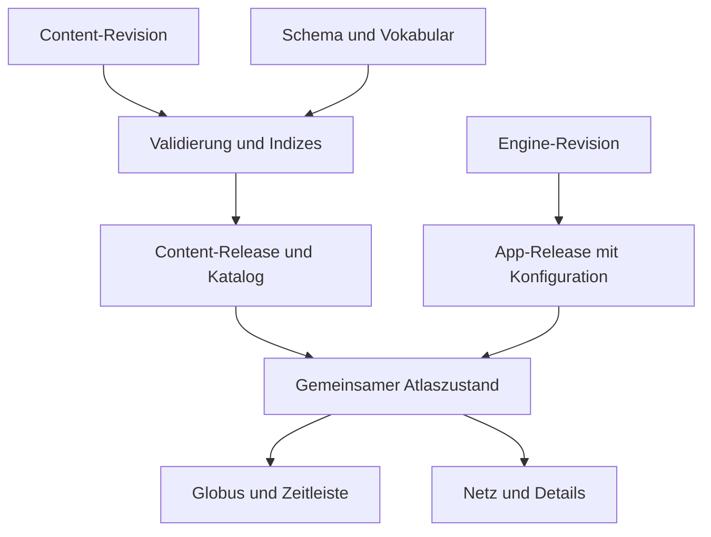

# Anthropologie-Atlas · Spezifikation 0.2

**Stand:** 22. November 2026, ergänzt um verbindliche URL- und Navigationsanforderungen · **Ziel der ersten App-Version:** 0.1.0 · **Datenvertrag:** 0.1.0, Entwurf bis zum Abschluss von M0.

Dieses Dokument ersetzt die bisherige kurze Weltatlas-Spezifikation. Es beschreibt ein webbasiertes, erweiterbares Lern- und Recherchewerkzeug für Geschichte, Gesellschaften, Sprachen, Schriften, Technik und ihre Verbindungen über Raum und Zeit. Es ist die gemeinsame Arbeitsgrundlage für zwei Repositories. Eine erste technische Implementierung liegt als 0.1.0-dev.1 vor. Der historische Referenzbestand ist noch zu recherchieren; der konkrete Umsetzungsstand steht in `STATUS.md`.

**Lesepfade:** Für die Produktidee: Abschnitte 1–3 und 11–13. Für Programmierung: 4–10 und 14–19. Für Bereitstellung und Content-URLs: insbesondere Abschnitt 14. Für Recherche: 4–9 und 17. Die mitgelieferten JSON-Schemas und fiktiven Beispieldaten konkretisieren den Vertrag; sie ersetzen weder die semantischen Prüfungen noch eine historische Prüfung.

`MUSS` kennzeichnet eine Abnahmebedingung. `SOLL` ist der Standard, von dem nur mit dokumentierter Begründung abgewichen wird. `KANN` bezeichnet eine optionale Erweiterung. Eine offene Entscheidung ist ausdrücklich als solche bezeichnet. Funktionen späterer Ausbaustufen gelten nicht automatisch als zugesagt für 0.1.0.

## Verbindliche Aktualisierung · direkte Browser-Auslieferung · 22. November 2026

Die jüngere Projektentscheidung ersetzt alle älteren Aussagen dieses Dokuments über TypeScript, Vite, Node/npm, Installationsschritte und Offline-Toolchains: Das Repository MUSS unmittelbar als statische Website funktionieren. Anwendung, Autorenwerkzeug und Tests verwenden direkt ausführbares Browser-JavaScript. Fertige Bibliotheken, Worker, Fonts und Grundkarte werden mitgeliefert. Bibliotheksupdates sind bewusste Maintainer-Commits. Kein App-Build und kein Paketmanager sind erforderlich.

`atlas.config.json` ist die zentrale Installationskonfiguration. Standard ist das öffentliche Content-Repo auf `main`; weitere Repos/Branches, feste Commits und lokale oder entfernte HTTP-Kataloge sind konfigurierbar. Branch-Profile verwenden `on-reload`; fixe Commit-Profile bleiben mit Katalog-Hash gepinnt. Ein leerer Entwurfskatalog darf `packages: []` und `defaultChapterId: null` besitzen, historische Releases bleiben davon ausgeschlossen. Die synthetische Demo wird nur ausdrücklich über `?demo=1` geöffnet.

Die aktuelle Dateistruktur liegt direkt im Repo-Wurzelverzeichnis: `index.html`, `authoring.html`, `src/`, `vendor/`, `fonts/`, `basemap/`, `licenses/`, `demo/content/`. `public/` und `dist/` entfallen. Browserbasierte Inhaltsprüfung und ZIP-Export ersetzen die Node-CLI. Details: [Architekturentscheidung 0002](decisions/0002-native-browser-distribution.md) und [Konfiguration](CONFIGURATION.md). Die fachlichen Regeln und Abnahmeziele bleiben gültig.

## Verbindliche Aktualisierung · Kapitelauswahl · 22. November 2026

Der normale Einstieg ist nun eine durchsuchbare Kapitelübersicht mit regionalen Epochen/Zeiträumen, Regionen, Themen und Mehrfachauswahl. Direkte Atlaslinks überspringen diesen Einstieg. `chapters` bezeichnet die ausgewählte Menge, `chapter` den Fokus. Menü, Objektlisten und Zähler, Karte, Netz und Zeitleiste beziehen sich auf diese Menge. Die Objektübersicht ist zusätzlich unabhängig von der Kartenzeit; mehrfach zugeordnete Objekte erscheinen einmal mit allen passenden Kapitelhinweisen. Ausgewählte Kapitel werden chronologisch sortiert.

Kapitel erhalten explizite `recordIds` sowie optionale `discovery`-Metadaten. Paketbesitz und Kapitelzugehörigkeit sind verschiedene Dinge. Der Entwurfsvertrag und der Compiler erzeugen einen gesonderten Discovery-Index. Details, URL-Kompatibilität, tatsächliche Messungen und Skalierungsgrenzen: [Entscheidung 0003](decisions/0003-chapter-discovery.md).

## Verbindliche Aktualisierung · Wanderungskarten · 22. November 2026

Entwicklungsstand dev.8 ergänzt explizite Richtungen für Bewegungsgeometrien, alternative Wanderungsereignisse, datierte Land-/Eis-Schnappschüsse und Kapitelstationen. Fundbelege bleiben unabhängig von gewählten Wegvarianten. Ein Modellzeitpunkt oder günstiges Umweltfenster MUSS als solches erklärt werden; daraus entsteht keine belegte Reisedauer. Es gibt keine automatische Küsten- oder Bewegungsinterpolation.

Die Capability `migration-maps` schützt ältere Viewer vor unbekannten Darstellungen. `spatial.direction`, die Rollen `land-reconstruction`/`ice-reconstruction`, `interpretationChoices.recordId` sowie lokalisierte Schritte mit optionalem Bildverweis sind in [Entscheidung 0006](decisions/0006-migration-maps.md) verbindlich beschrieben. Kartenstände benötigen eine zitierte `extent-of`-Aussage mit Zeitpunkt. Variantenvergleich und Kapitelstation werden im URL-Zustand erhalten; eine ausdrücklich leere Variantenauswahl bleibt auch nach Neuladen ein Vergleich.

## 1. Produkt und Erkenntnismodell

Nach der Kapitelwahl zeigt der Atlas einen drehbaren Globus, eine Zeitsteuerung und die ausgewählten Geschichtsräume. Besucher können von einem Ort zu einem Herrschaftsbereich, von dort zu einer Handelsbeziehung, einer Person, einer Sprache oder einem Gegenstand wechseln. Karte, Zeitleiste, Beziehungsnetz und Detailansicht zeigen unterschiedliche Ansichten derselben Datensätze.

Historische Räume dürfen sich geografisch und zeitlich überlagern. Ein Mensch gehört nicht genau einem Land, eine Sprache nicht genau einem Volk und eine Organisation nicht genau einem Reich. Moderne Länder sind eine mögliche Orientierungsebene. Sie bilden keine verbindliche Ablageordnung für den gesamten Datenbestand.

Die OLAP-Idee wird als kombinierbare Auswahl nach **Raum, Zeit, Entitätstyp, Beziehung, Thema und Quellenlage** umgesetzt. Eine bestimmte Datenbanktechnik oder ein ständig sichtbarer dreidimensionaler Zeitwürfel ist dafür nicht erforderlich. Die Kartenhöhe bleibt für räumliche Darstellung reserviert; Zeit wird in 0.1.0 über die Zeitleiste gesteuert.

### 1.1 Leitfragen der Oberfläche

1. Was ist in diesem Raum und dieser Zeit dokumentiert?
2. Welche Personen, Gruppen, Institutionen und Orte stehen miteinander in Verbindung?
3. Welche Veränderungen sind belegt, welche rekonstruiert und welche unbekannt?
4. Woher stammt diese Information, und welche andere Deutung gibt es?
5. Wie hängt ein ausgewählter Gegenstand, eine Erfindung, Sprache oder Schrift damit zusammen?

Die Anwendung MUSS unterschiedliche Wissensstände erkennbar machen. „Keine Daten im veröffentlichten Bestand“, „durch Filter ausgeblendet“, „Datierung unbekannt“ und eine ausdrücklich belegte Abwesenheit sind verschiedene Zustände. Eine leere Karte ist keine historische Aussage.

### 1.2 Fachliche Grundregeln

- Sprachgenealogie, Schriftentwicklung, Sprachgebrauch, Bevölkerung, politische Zugehörigkeit und kulturelle Übertragung sind eigene Beziehungstypen. Eine Beziehung wird nicht automatisch auf einen anderen Typ übertragen.
- Kontrolle, Anspruch, Einfluss, Verwaltungszugehörigkeit und Mitgliedschaft sind verschiedene Aussagen. Überlappende Flächen sind erlaubt und müssen verständlich auswählbar sein.
- Gemeinschaften und kulturelle Zuordnungen werden als historisch situierte, belegte Kategorien beschrieben. Das Modell setzt keine unveränderlichen oder biologisch homogenen Gruppen voraus.
- Eine Erstbezeugung ist keine automatische Erfindung; eine verbreitete Technik ist kein Beweis für eine einzige Übertragungsroute. Parallele Entwicklungen sind darstellbar.
- Epochen haben eine redaktionell und gegebenenfalls geografisch begrenzte Bedeutung. Eine regionale Epocheneinteilung darf nicht stillschweigend weltweit gelten.
- Ein Quellenzitat, eine Interpretation dieser Quelle und eine Rekonstruktion ihrer Geometrie bleiben unterscheidbar.
- Ein historischer Zusammenhang muss durch Daten und Belege entstehen. Die räumliche Nähe zweier Punkte oder ihre gemeinsame Auswahl erzeugt keine neue historische Beziehung.

### 1.3 Umfang der ersten Version

| In 0.1.0 abnehmen | Vorbereiten, anschließend ausbauen |
|---|---|
| MapLibre-Globus mit lokal ausgelieferter Grundkarte | Detailliertes Gelände, historische Küstenlinien und Stadtmodelle |
| Punkte, Linien, Flächen und datierte Gebietsstände | Große weltweite Datenbestände, zusätzliche Kachelformate |
| Gemeinsame Zeit- und Auswahlsteuerung | Gleichzeitiger Vergleich mehrerer Zeitfenster |
| vis-timeline und fokussiertes vis-network | Komplexe räumliche Netzanalysen und quantitative Auswertungen |
| Quellen je Datensatz und konkreter Aussage | Umfangreiche Quelleneditionen und Volltextkorpora |
| Deutsches und englisches Referenzkapitel | Vollständige Übersetzungen weiterer Inhalte und UI-Sprachen |
| Three.js-Objektbetrachter sowie ein einfaches Kartenmodell als technischer Nachweis | Umfangreiche Modelle und Animationen auf der Karte |
| Ein historisches Kapitel und ein zweites kleines Wiederverwendungskapitel | Redaktionell kuratierter Weltatlas mit vielen Kapiteln |
| Statische App, konfigurierbare Content-URL, vendorizierte Bibliotheken und Lizenzübersicht | PWA-Installation, explizite Offline-Pakete und optionale Redaktionsoberfläche |

Ein Browserkonto, ein dauerhaft laufendes Backend, eine Online-KI und eine serverseitige Datenbank sind keine Voraussetzungen für die Nutzung. Eine spätere Anbindung an Phine bleibt möglich; das Datenformat und die erste statische App benötigen diese Anbindung nicht.

## 2. Architektur und Verantwortlichkeiten

| Bestandteil | Verantwortung | Grenze |
|---|---|---|
| `anthropology-atlas-content` | Recherche, Quellen, historische Aussagen, Geometrien, Texte, Medien, Kapitel und Pakete | Enthält keine ausführbaren UI-Komponenten oder frei ausführbaren Skripte in Inhaltspaketen |
| `anthropology-atlas-engine` | Datenvertrag, Validator, Compiler, Browser-App, Renderer, UI und Veröffentlichungswerkzeuge | Enthält keine fest einprogrammierten historischen Sonderfälle |
| Veröffentlichter Atlas | Geprüfte Kombination einer Engine-Revision und einer Content-Revision | Lädt Inhalte über einen geprüften Katalog von der konfigurierten Quelle, optional GitHub Raw; keine GitHub-API im normalen Betrieb |

Die Inhalte werden durch einen eigenständigen Content-Build verarbeitet. App und Inhalt können zusammen oder getrennt ausgeliefert werden. Das Datenrepo muss keine Pages-Website veröffentlichen: Ein eigener statischer Host oder Raw-Dateien eines öffentlichen Repo-Commits können den Content-Katalog liefern. Jede Atlas-Instanz legt ihre Quelle in einer Konfigurationsdatei fest. Abschnitt 14 definiert die drei Bereitstellungsprofile.



### 2.1 Technischer Ausgangspunkt

- TypeScript im strikten Modus für Domänenmodell, Build und App; ESM-Module.
- Vite als anfänglicher Browser-Build. Die erste Oberfläche verwendet semantisches HTML, CSS und TypeScript-Komponenten. Ein späteres UI-Framework darf die Domänen- und Renderer-Schnittstellen nicht verändern.
- MapLibre GL JS für Karte und Globus, vis-network für Beziehungen, vis-timeline für Zeit, Three.js für Modelle.
- JSON Schema Draft 2020-12 für Strukturregeln; zusätzliche Domänenvalidierung für Beziehungen, Kalender, Geometrien, Dateien und Lizenzen. Ein strukturell gültiges JSON ist noch kein gültiges Recherchepaket. [T1]
- Kleine GeoJSON-basierte Datenpakete zuerst. Statische Vektorkacheln und räumliche Aufteilung gehören zur Build-Schicht, sobald gemessene Datenmengen das erfordern.
- Keine obligatorische Graphdatenbank, kein SPARQL-Endpunkt und kein GIS-Server im ersten Release. Stabile IDs und typisierte Kanten halten spätere Exporte offen.

Bibliotheksversionen werden im technischen Meilenstein M1 gemeinsam geprüft und anschließend exakt fixiert. Eine Versionsnummer wird nicht allein deshalb gewählt, weil sie in einer Online-Demo steht. Zusätzlich benötigte Integrationsbibliotheken werden nur mit dokumentierter Aufgabe und Lizenz in das Inventar aufgenommen.

### 2.2 Modulgrenzen der Engine

| Modul | Eingaben und Ausgaben |
|---|---|
| `domain` | Datensatztypen, Prädikate, historische Zeit und Filter; unabhängig von DOM, MapLibre, vis und Three.js |
| `catalog` | Laden von Manifesten und Chunks, Cache, ID-Auflösung, Versionsprüfung |
| `query` | Zeit-, Raum- und Beziehungsabfragen auf gemeinsamen Indizes |
| `state` | Serialisierbarer Atlaszustand und ausdrücklich benannte Aktionen |
| `map` | Projiziert fachliche Objekte in MapLibre-Layer; liefert IDs bei Auswahl zurück |
| `timeline` | Übersetzt historische Zeit in vis-timeline und zurück |
| `network` | Erstellt begrenzte Netzausschnitte und nachvollziehbare Kanten |
| `models` | Three.js-Viewer und separat austauschbarer MapLibre-Adapter |
| `ui` und `i18n` | Navigation, Details, Quellen, Design-Tokens und Lokalisierung |
| `tools` | Validieren, normalisieren, indizieren, Ressourcen prüfen, Releases erstellen |

Ein Renderer darf Daten nicht eigenständig historisch interpretieren. Die Entscheidung, welche Aussage im gewählten Zeitraum gilt, erfolgt vor dem Rendering im gemeinsamen Query-Modul. Auswahländerungen laufen über den Zustand; Renderer kommunizieren nicht gegenseitig über versteckte Eventketten.

## 3. Repositories und Ablageregeln

Die Repository-Namen sind vom Projekt festgelegt: **`anthropology-atlas-engine`** und **`anthropology-atlas-content`**. Account und vollständige URLs werden nach Anlage in Konfiguration und Dokumentation eingesetzt, nicht in Datensatz-IDs.

### 3.1 Programmrepository

| Pfad | Inhalt |
|---|---|
| `README.md`, `CONTRIBUTING.md`, `AGENTS.md` | Einstieg, Arbeitsablauf und Zuständigkeiten für Menschen und Agenten |
| `docs/SPECIFICATION.md` | Diese Spezifikation als maßgebliche fachliche Grundlage |
| `docs/decisions/` | Begründete Architekturentscheidungen und spätere Änderungen |
| `docs/design/` | BrandBook-Referenz, Tokens und Komponentenregeln |
| `schemas/0.1.0/` | Autoritative JSON-Schemas und versioniertes Prädikatvokabular |
| `src/domain/`, `src/query/`, `src/catalog/`, `src/state/` | Vom Rendering unabhängiger Kern |
| `src/map/`, `src/timeline/`, `src/network/`, `src/models/` | Adapter für die vier Ansichten |
| `src/ui/`, `src/i18n/` | Oberfläche, Komponenten und UI-Sprachen |
| `tools/validate/`, `tools/build/`, `tools/vendor/` | Inhalt prüfen, Releases bauen, Abhängigkeiten aktualisieren |
| `fixtures/reference-package/` | Kleine, ausdrücklich fiktive Daten für Vertrag und Integration |
| `tests/contract/`, `tests/integration/`, `tests/browser/` | Fachliche Randfälle, Build und Nutzungsabläufe |
| `public/basemap/`, `public/fonts/`, `public/licenses/` | Lokale Grundkarte, UI-Fonts und Rechtstexte mit Herkunftsmetadaten |
| `vendor/`, `vendor/manifest.json` | Fixierte Build-Abhängigkeiten und Nachweise |
| `content.lock.json`, `atlas.config.json` | Reproduzierbarer Deploymentstand und pro Installation konfigurierbare Content-Quelle |
| `THIRD_PARTY_NOTICES.md` | Lesbare Liste des tatsächlichen Releasebestands |
| `dist/` | Generierte App-Veröffentlichung; optional einschließlich eines gebündelten Content-Releases |

### 3.2 Datenrepository

| Pfad | Inhalt |
|---|---|
| `README.md`, `CONTRIBUTING.md`, `AGENTS.md` | Rechercheablauf und Regeln für Änderungen |
| `dataset.json` | Datensatzversion, Standardsprache, Lizenzvorgabe und veröffentlichbare Pakete |
| `contract.lock.json` | Fixierte Engine-Vertragsrevision und Prüfsumme des Autorenwerkzeugs |
| `entities/<type-plural>/<slug>.json` | Eine Entität; zum Beispiel `entities/people/<slug>.json` |
| `assertions/<predicate>/<slug>.json` | Eine belegte, zeitlich eingeordnete Aussage |
| `events/<event-type>/<slug>.json` | Ein Ereignis oder länger andauernder Vorgang |
| `geometries/<points\|lines\|areas>/<slug>/geometry.json` | Metadaten, Herkunft und Qualität einer Geometrie |
| `geometries/<points\|lines\|areas>/<slug>/shape.geojson` | Zugehörige reine GeoJSON-Feature-Datei |
| `sources/<slug>.json` | Bibliografischer Datensatz |
| `interpretations/<slug>.json` | Zusammengehörige alternative Aussagen und ihre Erklärung |
| `assets/<models\|images\|fonts\|documents>/<slug>/asset.json` | Herkunft, Lizenz, Beschreibung und lokale Dateien eines Assets |
| `chapters/<slug>/chapter.json` | Einstieg, Auswahl und Ablauf eines Atlas-Kapitels |
| `chapters/<slug>/<language-tag>.md` | Lokalisierte Kapiteltexte |
| `packages/<slug>/manifest.json` | Explizite Datensatzliste und Paketabhängigkeiten |
| `docs/research/` | Recherchenotizen und dokumentierte Lücken; nicht automatisch veröffentlicht |
| `tooling/` | Unveränderte lokale Kopie des fixierten Autorenwerkzeugs und seiner Schemas |
| `published/` auf einem optionalen Veröffentlichungsbranch | Generierter Katalog, Indizes, Chunks und Payloads für direkten HTTP-/GitHub-Raw-Zugriff |

**Eine logische Einheit pro Metadatendatei.** Große Geometrie- und Mediendateien liegen als Payload daneben. Pfade der Payloads werden relativ zur jeweiligen Metadatendatei aufgelöst. Dadurch funktionieren verschobene Repositories und Veröffentlichungen unter Unterpfaden.

Die Schemahoheit liegt im Engine-Repo. `tooling/` im Datenrepo ist eine versionierte, maschinell erzeugte Kopie für unabhängige lokale Prüfung. Sie wird nicht von Rechercheagenten bearbeitet. Ein Engine-Release liefert das Autorenwerkzeug mit Schemas, semantischem Validator, Vokabular, Abhängigkeiten und Lizenzliste als überprüfbares Paket aus.

### 3.3 Stabile Identitäten und Sortierung

- IDs haben die Form `<namespace>:<slug>`, etwa `person:demo-traveller`, `assertion:demo-trade-a` oder `geometry:demo-area-a`. Der vollständige ID-String ist repo-weit eindeutig.
- Slugs enthalten Kleinbuchstaben, Ziffern und Bindestriche. Sie sind keine Anzeigenamen und ändern sich bei Übersetzungen nicht. Eine falsche Zuordnung wird durch eine dokumentierte Migration berichtigt, nicht durch Wiederverwendung der ID für ein anderes Objekt.
- Entitäts-IDs verwenden den Entitätstyp als Namespace. Andere Datensätze verwenden `assertion`, `event`, `geometry`, `source`, `interpretation`, `asset`, `chapter` oder `package`.
- Ein Pfad ergibt sich aus Datensatzklasse, Typ beziehungsweise Prädikat und Slug. Groß-/Kleinschreibung, `..`, absolute Pfade und Symlinks aus dem Inhaltswurzelverzeichnis heraus sind nicht zulässig.
- JSON wird als UTF-8 mit zwei Leerzeichen Einrückung und abschließendem Zeilenumbruch geschrieben. Ungeordnete ID-Listen sind lexikografisch sortiert. Wegpunkte, Kapitelabschnitte, Namenspräferenzen und andere fachlich geordnete Listen behalten ihre Reihenfolge.
- Datensätze werden nicht nach heutigen Ländern oder Jahrtausenden kopiert. Diese Dimensionen werden über Referenzen, Zeitangaben, räumliche Aussagen und Pakete erschlossen.
- Entfernte veröffentlichte IDs dürfen nicht neu vergeben werden. Eine ID-Migration benötigt eine Zuordnung in `docs/migrations/` und einen maschinenlesbaren Redirect im nächsten Vertragsstand; bis diese Funktion umgesetzt ist, bleibt die alte ID als `withdrawn` erhalten.

## 4. Datensatzklassen und gemeinsame Felder

Das Wissensmodell besteht aus Entitäten, Aussagen und Ereignissen. Quellen und Geometrien belegen beziehungsweise verorten sie. Pakete bestimmen die Auslieferung; Kapitel bestimmen die Vermittlung.

| Datensatzklasse | Zweck |
|---|---|
| `entity` | Identität eines Gegenstands des Atlas, unabhängig von einer einzelnen Karte |
| `assertion` | Eine typisierte, datierte Aussage zwischen zwei Entitäten; optional mit räumlicher Darstellung |
| `event` | Vorgang mit mehreren Beteiligten, Rollen, Zeitraum, Ort oder Bewegung |
| `geometry` | Wiederverwendbare Form mit dokumentierter Herkunft und räumlicher Qualität |
| `source` | Bibliografie einer Quelle; ihr Publikationsdatum ist nicht die Zeit ihres Gegenstands |
| `interpretation` | Explizite Gruppe alternativer Aussagen zu derselben Frage |
| `asset` | Lokale Bild-, Modell-, Schrift- oder Dokumentdatei samt Rechten |
| `chapter` | Redaktioneller Einstieg in einen begrenzten Ausschnitt |
| `package` | Auslieferbare Menge von Datensätzen mit Abhängigkeiten |

### 4.1 Gemeinsamer Kopf

Jeder Metadatensatz hat `schemaVersion`, `kind`, `id`, `editorial` und `sourceRefs`. `sourceRefs` darf bei technischen Bündeln und bibliografischen Quellen leer sein. Eine öffentlich gezeigte historische Behauptung benötigt dagegen passende Belege. `synthetic: true` kennzeichnet Testdaten und schließt sie vom normalen historischen Release aus.

`editorial.status` ist `draft`, `reviewed` oder `withdrawn`. Bei `reviewed` sind `reviewedBy` und `reviewedAt` erforderlich; ein Agent darf keine menschliche Prüfung behaupten. `reviewedBy` benennt nachvollziehbar den tatsächlichen Prüfer beziehungsweise Prüfprozess. Der Status bezeichnet die redaktionelle Bearbeitung, nicht historische Gewissheit. Die Historie der Bearbeitung bleibt im Git-Verlauf; die historischen Zeitfelder enthalten keine Commit-Daten.

`recordLicense` kann die Standardlizenz aus `dataset.json` überschreiben. Eine nicht entschiedene Lizenz ist im Entwurf sichtbar, blockiert jedoch die Veröffentlichung. Die Lizenz für Beschreibungsdaten ist von der Lizenz eines verlinkten Werkes oder einer lokal ausgelieferten Datei getrennt.

### 4.2 Entitäten

Entitäten benötigen `entityType` und `labels`. Optional sind `summary`, `names`, `externalIds`, `samples` und `assetIds`. `labels` und `summary` sind Objekte mit Sprachkennzeichen als Schlüsseln. `names` kann Originalnamen, Varianten, Transliteration, Geltungszeit und eigene Quellenverweise enthalten. Identität bleibt dabei unabhängig von wechselnden Namen.

| `entityType` | Ordner | Bedeutung |
|---|---|---|
| `place` | `places` | Stadt, Fundort, Siedlung oder anderer identifizierbarer Ort |
| `region` | `regions` | Benannter räumlicher Bezugsbereich, auch ohne politischen Status |
| `polity` | `polities` | Reich, Staat, Stadtstaat, Herrschaftsverband |
| `community` | `communities` | Historisch definierte Gemeinschaft oder Bevölkerungsgruppe |
| `organization` | `organizations` | Institution, Kirche als Organisation, Orden, Gilde oder Verein |
| `person` | `people` | Historische Person |
| `language` | `languages` | Sprache oder ausdrücklich definierte historische Sprachstufe |
| `language-family` | `language-families` | Sprachfamilie beziehungsweise Untergruppe |
| `script` | `scripts` | Schrift oder ausdrücklich definierte Schrifttradition |
| `technology` | `technologies` | Technik, Verfahren oder Erfindung als Konzept |
| `artifact` | `artifacts` | Einzelner Gegenstand oder klar bezeichnete Objektklasse |
| `specimen` | `specimens` | Fossil, natürliche Probe oder klar bezeichnete Fundgruppe |
| `taxon` | `taxa` | Biologische Art oder andere ausdrücklich bezeichnete taxonomische Einheit |
| `commodity` | `commodities` | Handelsgut oder Rohstoff |
| `religion` | `religions` | Religiöse Tradition; nicht identisch mit einer Institution |
| `period` | `periods` | Benannte Epoche mit eigenem Geltungsbereich |
| `concept` | `concepts` | Sonstiger fachlich definierter Begriff; keine Ausweichkategorie für unbekannte Typen |

Zeitabhängige Tatsachen stehen grundsätzlich in Aussagen oder Ereignissen: Aufenthalt, Herrschaft, Sprachgebrauch, territoriale Ausdehnung, Entstehung und Auflösung. `summary` ist eine belegte Einführung, keine zweite versteckte Faktendatenbank. Die Zuordnung einer Person zu einem heutigen Staat darf nicht allein aus ihrem Geburtsort abgeleitet werden.

Externe Kennungen sind zusätzliche Verweise, etwa zu einem Museumskatalog. Sie ersetzen keine lokalen IDs, erfordern keinen Onlineabruf und werden nicht automatisch als Beleg übernommen.

### 4.3 Aussagen und Beziehungsvokabular

Eine Aussage enthält `subjectId`, `predicate`, `objectId`, `time`, `epistemic` und `sourceRefs`. Beide Endpunkte sind Entitäten. `spatial` enthält bei Bedarf Geometrieverweise mit einer expliziten Rolle. `scopeIds` begrenzt die Aussage auf Regionen, Gemeinschaften oder andere fachlich passende Entitäten.

`epistemic` enthält `status: attested | inferred | hypothetical | disputed` und bei Bedarf eine mehrsprachige Erklärung. Es bezeichnet den Charakter der Aussage. Eine zahlenmäßige „KI-Sicherheit“ wird nicht als historische Wahrscheinlichkeit ausgegeben.

| Prädikat | Subjekt → Objekt | Bedeutung und Zusatzregeln |
|---|---|---|
| `located-at` | Ort, Person, Artefakt, Institution → Ort oder Region | Belegter Standort/Aufenthalt; Punkt optional über `spatial` |
| `extent-of` | Region → Region | Geografische Ausdehnung in einem Bezugsraum; Fläche erforderlich |
| `controls` | Herrschaftsverband oder Organisation → Ort/Region | Tatsächliche Kontrolle; flächenhafte Darstellung benötigt `extent` |
| `claims` | Herrschaftsverband oder Organisation → Ort/Region | Anspruch; eigener Kartenstil, keine Umdeutung zu Kontrolle |
| `influences` | Entität → Entität | Erläuterte Einflussbeziehung mit enger Quellenbindung |
| `part-of` | Entität → Entität | Zeitabhängige Zugehörigkeit, keine universelle Vererbung anderer Eigenschaften |
| `member-of` | Person oder Organisation → Organisation | Mitgliedschaft |
| `holds-office-in` | Person → Herrschaftsverband oder Organisation | Amt; Rolle in der Erklärung, optional Ereignis zur Ernennung |
| `trades-with` | Ort, Herrschaftsverband, Gemeinschaft oder Organisation ↔ gleicher Typbereich | Symmetrische Beziehung; Waren in `scopeIds`, Linie nur mit gekennzeichneter Bedeutung |
| `allied-with` | Herrschaftsverband oder Organisation ↔ gleicher Typbereich | Zeitgebundenes Bündnis |
| `uses-language` | Gemeinschaft, Organisation, Region oder Person → Sprache | Belegter Gebrauch; keine Gleichsetzung mit allen Bewohnern einer Fläche |
| `written-in` | Sprache → Schrift | Nutzung einer Schrift in einem begrenzten Kontext |
| `language-descends-from` | Sprache → Sprache | Sprachgeschichtliche Abstammung |
| `member-of-language-family` | Sprache oder Sprachfamilie → Sprachfamilie | Genealogische Klassifikation |
| `script-derived-from` | Schrift → Schrift | Schriftentwicklung; überträgt keine Sprachfamilie |
| `uses-technology` | Gemeinschaft, Organisation, Herrschaftsverband oder Person → Technik | Anwendung beziehungsweise Übernahme |
| `attested-at` | Sprache, Schrift, Technik, Artefakt oder Gemeinschaft → Ort/Region | Bezeugung; kein automatisch frühester Ursprung |
| `period-applies-to` | Epoche → Region, Gemeinschaft oder Herrschaftsverband | Geltungszeit und Kontext einer Epocheneinteilung |

Seit dev.7 ergänzen `has-genetic-ancestry-from` (Person/Fossil → Taxon, gerichtet) und `genetically-related-to` (Person/Fossil ↔ Person/Fossil, symmetrisch) genetische Abstammung und biologische Verwandtschaft. Bei Fossilien ist ausdrücklich das beprobte Individuum gemeint; kein beliebiges Fossilkollektiv. `time` datiert die beprobten Individuen beziehungsweise den Belegrahmen, nicht den Zeitpunkt eines unbekannten Zeugungs- oder Wanderereignisses. `note` erläutert Methode, Bedeutung und Grenzen; mindestens ein `supports`-Beleg mit Fundstelle ist auch im Entwurf erforderlich. Nur räumliche `connection` ist zulässig, keine Route oder Ausdehnung. Die Beziehungen behaupten weder eine Volkszugehörigkeit noch Sprach- oder Kulturverwandtschaft; sie werden nicht transitiv ergänzt. Datierung und epistemischer Status bleiben getrennt. Details und synthetische Beispiele: [Entscheidung 0005](decisions/0005-genetic-relationships.md).

Dieses Vokabular ist im Engine-Vertrag versioniert. Neue Prädikate benötigen mindestens Richtung, zulässige Endpunkte, Zeitsemantik, räumliche Rollen, Beschriftung und eine Validatorregel. Ein Rechercheagent darf nicht nach Belieben `relatedTo` erfinden. Die generische Detailansicht kann neue Inhalte darstellen; neue fachliche Semantik braucht eine Vertragsänderung.

Symmetrische Beziehungen werden nur einmal gespeichert: Subjekt-ID lexikografisch vor Objekt-ID. Mehrere unabhängige Belege für dieselbe Aussage werden in `sourceRefs` ergänzt. Fachlich unterschiedliche oder widersprüchliche Aussagen erhalten eigene IDs. Verbindungen zu Ereignissen werden über deren Beteiligtenrollen erzeugt, nicht als erfundene binäre Aussage.

### 4.4 Ereignisse und Bewegungen

`eventType` umfasst zunächst `battle`, `war`, `campaign`, `migration`, `journey`, `invention`, `adoption`, `foundation`, `dissolution`, `birth`, `death`, `treaty`, `attestation` und `other`. `other` benötigt eine fachliche Erklärung.

Ein Ereignis besitzt `labels`, `time`, `participants` mit `entityId` und `role`, optional `placeIds`, `spatial` und `waypoints`. Rollen werden pro Ereignistyp geprüft. Mehrere Teilnehmer auf mehreren Seiten sind möglich. Ein Feldzug kann Schlachten über `parentEventId` bündeln; Selbstbezüge und Zyklen sind ungültig.

Eine Bewegung speichert ihre belegten Stationen in fachlicher Reihenfolge, jeweils mit Ort oder Punktgeometrie, eigener Datierung und Belegen. Die Linie zwischen Stationen kann eine Rekonstruktion oder bloß schematische Verbindung sein. Eine animierte Figur darf keine scheinbar belegte Reisegeschwindigkeit erzeugen: Zwischen undatierten Stationen ist eine zeitgenaue Animation ausgeschaltet; schematische Animationen werden als solche bezeichnet.

### 4.5 Alternative Deutungen

Ein `interpretation`-Datensatz gruppiert mindestens zwei Aussage-IDs oder ausdrücklich als Hypothesen beschriebene Wanderungsereignisse, nennt die fachliche Frage und erklärt die Unterschiede. Die Aussagen behalten ihre eigenen Quellen, Zeiten und Geometrien. Ein Kapitel kann bewusst eine Variante auswählen, muss diese Auswahl erklären. Ohne Auswahl zeigt die Karte einen Hinweis und ermöglicht Vergleich; sie entscheidet nicht nach Dateireihenfolge.

Gleichzeitige Kontrolle und Anspruch sind keine automatisch widersprüchlichen Alternativen. Ebenen dürfen legitim überlappen. Auch zwei Aussagen mit verschiedenen räumlichen Auflösungen sind nicht schon deswegen Konkurrenzvarianten.

## 5. Zeitmodell

Zeit ist ein eigener fachlicher Datentyp. Sie darf weder als beliebiger Datumsstring noch als Datenbank-`DATE` gespeichert werden. Der Veröffentlichungszeitpunkt einer Quelle, der historische Geltungszeitraum einer Aussage und der Prüfzeitpunkt eines Datensatzes sind getrennte Felder.

### 5.1 Kalender und Jahreszählung

Der normalisierte Vertrag verwendet einen proleptischen gregorianischen Rechenkalender mit astronomischer Jahreszählung. Das ist eine technische Vergleichsgrundlage, keine Behauptung darüber, welchen Kalender historische Menschen benutzt haben. In der deutschen Oberfläche werden v. Chr./n. Chr. verwendet, in Englisch BCE/CE. Ein sichtbares Jahr null gibt es dort nicht.

| Historische Anzeige | Gespeicherter `year` |
|---|---:|
| 44 v. Chr. | -43 |
| 2 v. Chr. | -1 |
| 1 v. Chr. | 0 |
| 1 n. Chr. | 1 |
| 99 n. Chr. | 99 |

Ein normalisiertes Datum besteht immer aus `year`, `month` und `day`. Die tatsächliche Genauigkeit steht zusätzlich in `precision`. Der unterstützte Bereich reicht seit dev.6 von `year = -1000000` bis `year = 2100`. Quelldaten außerhalb dieses Bereichs werden als nicht unterstützt gemeldet und nicht abgeschnitten. Die BP-Erweiterung und explizite Altersuntergrenzen sind in Entscheidung 0004 beschrieben. Andere Datierungsskalen erfordern weiterhin eigene dokumentierte Umrechnungen.

Historische Originalangaben können unter `original` als `text`, `calendar` und optional `conversionNote` erhalten bleiben. Tagesgenaue julianische oder andere Kalenderdaten dürfen nur mit dokumentierter Umrechnung normalisiert werden. Ein unsicheres Datum wird durch eine Umrechnung nicht genauer.

Für Jahreszahlen vor -10000 verwendet die Oberfläche standardmäßig BP (Jahre vor 1950). Dies ändert weder Kalenderumrechnung noch gespeicherte epoch days; BP bedeutet hier keine automatische Radiokohlenstoffkalibrierung.

### 5.2 Eine Datierung mit Unsicherheit

Die Kalenderform von `TimeEstimate` besitzt `earliest`, `latest`, `precision` und `qualifier`. Beide Grenzen sind **inklusive mögliche Kalendertage**. `precision` ist `day`, `month` oder `year`; `qualifier` ist `exact`, `approximate` oder `uncertain`.

```json
{
  "earliest": {"year": 1300, "month": 1, "day": 1},
  "latest": {"year": 1300, "month": 12, "day": 31},
  "precision": "year",
  "qualifier": "exact"
}
```

Dieses Beispiel bedeutet **„im Jahr 1300; der Tag ist unbekannt“**. `exact` bezieht sich auf die angegebene Präzision. Es bedeutet hier nicht „am 1. Januar“. Für „um 1300“ muss die Recherche einen begründeten Unsicherheitsbereich angeben und `approximate` setzen. Die Engine erfindet keine pauschalen ±10 Jahre.

Die Grenzen müssen zur Präzision passen: Eine Jahresangabe umfasst ganze mögliche Jahre, eine Monatsangabe ganze mögliche Monate. Bei Tagespräzision sind einzelne Tage oder begründete Tagesbereiche möglich. Ein genaues Jahr hat denselben Jahreswert an beiden Grenzen, ein genauer Monat denselben Monat; ein genauer Tag dieselben Grenzdaten. Eingabehilfen dürfen diese Grenzen erzeugen, aber nicht willkürlich wählen.

Die alternative Altersform lautet `{basis:"years-before", referenceYear:1950, older:420000, younger:380000, central:400000, uncertaintySigma:1, precision:"year", qualifier:"approximate"}`. `central` und `uncertaintySigma` sind optional; Sigma erfordert symmetrische Grenzen um den Zentralwert. Die angegebenen statistischen Grenzen werden als Such- und Darstellungsbereich verwendet, nicht als absolute Wahrscheinlichkeitsgrenzen. Quellen und Notizen erklären die Datierungsmethode.

### 5.3 Zeitpunkt, Zeitraum und fehlende Datierung

- `{"kind":"before","bound": TimeEstimate}`: expliziter Nachweis „älter als diese datierte Grenze“. Die ältere Grenze bleibt offen; die interne Untergrenze der Engine ist nur ein Abfrageclip, kein behauptetes Alter. Kein vollständig enthaltener Zeitraum und keine Dauer.


- `{"kind":"instant","at": TimeEstimate}`: einmaliges Ereignis oder zeitliche Momentaufnahme. Eine unsicher datierte Momentaufnahme behauptet keinen über die ganze Unsicherheitsspanne andauernden Zustand.
- `{"kind":"interval","start": TimeEstimate|null,"end": TimeEstimate|null,"endMeaning":"ended"|"last-attested"}`: Zustand oder Vorgang. Das Ende bezeichnet den letzten möglichen enthaltenen Tag, nicht den ersten ausgeschlossenen Tag. `last-attested` bedeutet „bis dahin belegt“, nicht „damals beendet“.
- `{"kind":"unknown"}`: Datierung fehlt vollständig.

Ein `null` am Anfang oder Ende bedeutet **unbekannt**, niemals minus/plus unendlich. Solche Datensätze erscheinen in einer eigenen undatierten beziehungsweise teilweise datierten Ergebnisgruppe. Sie erzeugen keine automatisch für beliebige Jahrhunderte gültige Kartenfläche. Für gewöhnliche zeitgefilterte Flächen in 0.1.0 müssen beide Grenzen bekannt sein. Eine Forschungsnotiz kann eine offene Grenze dokumentieren, bis der Bestand präzisiert wird.

### 5.4 Normalisierung und Filter

Der Compiler wandelt Datumsgrenzen in ganzzahlige `epochDay`-Werte um: Tag 0 ist 1970-01-01 im Rechenkalender. Es gibt keine lokale Zeitzone. Die Zahl ist eine abgeleitete Repräsentation und wird nicht zusätzlich von Rechercheagenten gepflegt.

Laufzeitbereiche sind halboffen: `[fromDay, toDayExclusive)`. Ein inklusiver letzter Tag wird durch Addition von 1 in die obere Grenze umgerechnet. Für einen Zeitraum mit Startgrenzen `sMin/sMax` und Endgrenzen `eMin/eMax` gilt:

- mögliche Hülle: `[sMin, eMax + 1)`;
- gemeinsamer zeitlicher Kern aller zulässigen Varianten: `[sMax, eMin + 1)`, falls diese Spanne nicht leer ist;
- mindestens eine zulässige Reihenfolge muss existieren: `sMin <= eMax`;
- `sMax > eMin` kann bei unsicheren Grenzen vorkommen; dann gibt es keinen gemeinsamen Kern, nicht automatisch einen Datenfehler.

Die Standardabfrage nimmt mögliche Überschneidungen auf und kennzeichnet Unsicherheit. Bei einer Momentaufnahme wird ihre Datierungsspanne als möglicher Trefferbereich behandelt, nicht als Dauer. Ein Jahrescursor fragt das gesamte gewählte Jahr ab; mehrere Wechsel innerhalb dieses Jahres erscheinen als mehrere datierte Stände und werden nicht zu einer einzigen gleichzeitigen Karte verschmolzen. Die UI erlaubt dann eine genauere Zeitauswahl.

Ein zusätzlicher Zeitraumfilter verwendet `overlap` oder ausdrücklich `contained`; die Semantik wird im URL-Zustand mitgeführt. Ein Vergleich `[a,b)` mit `[c,d)` überschneidet sich genau dann, wenn `a < d && c < b`. Prüfregeln unterscheiden zeitliche Unschärfe von der Zuverlässigkeit der historischen Aussage.

### 5.5 vis-timeline-Adapter

vis-timeline erhält ausschließlich über einen getesteten Adapter erzeugte Werte. Bei tiefer Vorgeschichte skaliert dieser linear 1000 historische Tage auf einen Renderer-Tag; Achsen, Cursor und Rückübersetzung verwenden weiter historische Jahre. Datierte Inhalte aller ausgewählten Kapitel bestimmen den Modus, auch wenn der Cursor jüngere Jahre auswählt. Eigene Achsen- und Tooltipformatierung stellt die historische Jahreszählung her. Die Dokumentation bietet Anpassungen für Zeitdarstellung und Locale; diese allein garantieren noch keine korrekte BCE-Darstellung. [T2]

Vor dem weiteren Ausbau sind Jahre vor und nach der Zeitenwende, Jahre 1–99, Schaltjahre, Monatswechsel und negative Jahre zu prüfen. `new Date(year, …)` ist keine allgemeine Konvertierungsfunktion des Atlas; insbesondere die Sonderbehandlung der Jahre 0–99 wird vermieden. [T16] Der Renderer darf keine Browser-Datumsstrings aus Quellen parsen. Die originale Quellenangabe bleibt im Detail sichtbar.

## 6. Geografie und historische Kartenstände

### 6.1 Geometrievertrag

Jeder Geometriedatensatz verweist mit `file` auf eine lokale GeoJSON-Datei. Diese enthält genau ein `Feature`, dessen `id` der Geometrie-ID entspricht. Die eigentliche Form verwendet WGS84-Längen- und Breitengrade in der Reihenfolge **`[longitude, latitude]`**. Ein eigenes `crs`-Feld wird nicht verwendet. Das folgt GeoJSON/RFC 7946. [T3]

0.1.0 unterstützt `Point`, `MultiPoint`, `LineString`, `MultiLineString`, `Polygon` und `MultiPolygon`. `GeometryCollection` bleibt zunächst ausgeschlossen; separate Datensätze sind besser belegbar. GeoJSON-Eigenschaften enthalten keine konkurrierenden historischen Fakten; diese stehen in den referenzierenden Aussagen.

`geometry.json` besitzt zusätzlich:

| Feld | Bedeutung |
|---|---|
| `geometryType` | Erwarteter GeoJSON-Typ, mit der Payload abzugleichen |
| `method` | `measured`, `digitized`, `reconstructed` oder `schematic` |
| `accuracy` | `unknown` oder `estimated` mit begründeter `meters`-Angabe und optionaler Erklärung |
| `sourceRefs` | Quellen der Form, mit Kartenblatt/Fundstelle, wo vorhanden |
| `processingNote` | Herkunft und Bearbeitung, insbesondere Georeferenzierung und Vereinfachung |
| `rights` | Herkunfts-URL beziehungsweise Herkunftserklärung, Urheber, Lizenz und Zuschreibung |

Die Geltungszeit der historischen Zuordnung steht in der Aussage. Dieselbe Form kann mehrfach verwendet werden, ohne dass ihr Dateiname eine fortwährende Gültigkeit behauptet. Der Compiler kann mehrere Detailstufen erzeugen; die Originalform bleibt unverändert.

### 6.2 Bedeutung der Form

`spatial` verbindet einen Datensatz mit `geometryId` und `role`. Zulässige Rollen sind zunächst `location`, `extent`, `route`, `connection`, `findspot` und `uncertainty-area`. Die Prädikatprüfung legt fest, welche davon fachlich passen.

- Eine Linie mit `connection` visualisiert einen Zusammenhang. Sie behauptet keinen tatsächlichen Reiseweg.
- Eine Route benötigt belegte Stationen oder ausdrücklich rekonstruierte Abschnitte.
- Ein unsicherer Fundort kann eine `uncertainty-area` statt eines scheinbar präzisen Punktes haben.
- Ein Reich erhält mehrere datierte Aussagen mit den jeweiligen Flächen. „Reich“ und „Polygon“ sind keine identischen Objekte.
- Kontrolle kann flächig, Anspruch gestrichelt und unsichere Ausdehnung durch zurückhaltende Muster dargestellt werden. Farbe allein reicht nicht für diese Unterscheidung.

### 6.3 Kartenstände und Übergänge

Zwischen zwei Momentaufnahmen wird weder die Form interpoliert noch der ältere Stand automatisch bis zum nächsten Datum verlängert. Eine flächige Gültigkeit zwischen zwei Daten benötigt eine eigene Intervallaussage. Ist für das gewählte Datum kein passender Stand vorhanden, zeigt die UI die Datenlücke.

Eine optionale Funktion „Nächsten belegten Stand zeigen“ darf ein anderes Datum laden, muss jedoch Kartenzeit und Belegdatum sichtbar unterscheiden. Animation wechselt zwischen vorhandenen Ständen; eine weiche Überblendung ist ein visueller Übergang und keine behauptete historische Grenzbewegung.

### 6.4 Geometrieprüfung

Die semantische Prüfung MUSS mindestens kontrollieren: endliche Zahlen, Koordinatenbereiche, geschlossene Ringe, Mindestpunktzahlen, Innen-/Außenringe, Selbstüberschneidungen, degenerierte Flächen, Löcher außerhalb ihrer Außenringe und Übereinstimmung von Typ und Ordner. Warnungen zu Vereinfachung und Genauigkeit bleiben Teil des Berichts.

Objekte über dem 180. Längengrad werden kontrolliert geteilt, damit eine kurze Verbindung nicht um die ganze Welt gezeichnet wird. Der Build bewahrt die gemeinsame Datensatz-ID für die Teilformen. Dateline-übergreifende Suchfenster werden in zwei normale Fenster zerlegt. Diese Behandlung und die Ringorientierung folgen einem ausdrücklich getesteten GeoJSON-Importprofil. [T3]

### 6.5 Grundkarte, Globus und Zoom

Die Grundkarte liefert zunächst Küsten, Landflächen, Gewässer und zurückhaltende Orientierung. Natural Earth ist ein geeigneter Ausgangskandidat; dessen Lizenzstatus und Datenmaßstab werden im Releaseinventar festgehalten. Es ist keine historische Grenzdatenbank. [T4]

Die Oberfläche kennzeichnet die Grundkarte als heutige physische Orientierung, soweit keine historischen Rekonstruktionen vorliegen. Gegenwärtige Staatsgrenzen sind eine abschaltbare Orientierungsebene, keine unhinterfragte Unterteilung vergangener Welten.

MapLibre wird im Globusmodus gestartet. Die dokumentierte Implementierung kann beim Hineinzoomen in eine lokale Mercator-Darstellung übergehen. Das Projekt übernimmt diesen technischen Übergang zunächst, prüft ihn sichtbar und verspricht keine permanent rein sphärische Projektion bis zum letzten Zoom. Eine fest sphärische Nahansicht wäre eine gesonderte technische Anforderung. [T5]

Auch eine perspektivisch auf dem Bildschirm gezeigte Kugel erlaubt keinen unverzerrten Flächenvergleich an jeder Bildschirmposition. Flächen- und Distanzwerte werden aus geografischen Daten berechnet, nicht aus Bildschirmabständen. Der Globus vermeidet die bekannte weltweite Ausdehnung einer ausgerollten Mercatorkarte als Hauptansicht.

Die Zielauflösung am tiefsten vorgesehenen Atlaszoom beträgt ungefähr **200 Meter je CSS-Pixel am Kartenzentrum**, also 20 km auf 100 CSS-Pixel. Sie wird lokal gemessen; ein fester Zoomwert oder eine Messung in physischen Displaypixeln genügt nicht. Die Maßstabsleiste und ein Reset auf den Kapitelblickwinkel gehören zur Oberfläche.

Diese Anzeigeauflösung ist keine Genauigkeitszusage für Quelldaten. Ein grober historischer Grenzverlauf darf auch bei hohem Zoom grob bleiben. Polare Daten, Antimeridian und das Verhalten am Horizont sind eigene M1-Prüffälle. Falls der gewählte Renderer eine polare Detailansicht nicht unterstützt, muss diese Grenze benannt werden; Daten dürfen nicht still verschwinden.

## 7. Quellen, Rechte und redaktionelle Prüfung

### 7.1 Quellenverzeichnis

Ein `source` besitzt mindestens `title` und `sourceType`. Weitere Felder sind `creators`, `published`, `publisher`, `containerTitle`, `identifiers`, `url`, `accessedAt`, `language`, `bibliographicNote` und optional `assetId` für eine rechtmäßig lokal ausgelieferte Kopie. Ein Buch ohne URL ist vollständig zitierbar.

`sourceType` unterscheidet beispielsweise `book`, `article`, `catalog`, `archive`, `dataset`, `website`, `object` und `synthetic`. `published` ist eine bibliografische Zeichenfolge, kein historischer Zeitraum. Mehrere Ausgaben oder Übersetzungen können unterschiedliche Quellen-IDs benötigen, wenn ihre Fundstellen nicht austauschbar sind.

Ein Quellenverweis besitzt `sourceId`, `role`, optional `locator`, `note` und `appliesTo`. `role` ist `background`, `supports`, `challenges` oder `derivation`. `appliesTo` nennt bei Bedarf JSON-Pointer innerhalb des zitierenden Datensatzes, etwa `/time/start`. Der Validator prüft, dass der Pointer auf ein vorhandenes Feld zeigt.

Eine Hintergrundquelle an einer Entität erfüllt nicht automatisch die Belegpflicht für jede mit ihr verbundene Behauptung. Für veröffentlichte Aussagen und Ereignisse ist mindestens ein tragender Beleg mit nachvollziehbarer Fundstelle erforderlich. Bei Quellen ohne Seiten oder Abschnitte kann `locator` eine Objekt-ID oder eine ausdrücklich bezeichnete Gesamtaussage nennen. Ein Link allein erklärt nicht, welcher Inhalt belegt wird.

### 7.2 Veröffentlichung und Qualitätsstufen

`draft`-Datensätze sind in der lokalen Vorschau sichtbar. Ein historisches Release enthält standardmäßig nur `reviewed`-Datensätze und deren geprüfte Abhängigkeiten. Verweist ein freigegebenes Kapitel auf einen Entwurf, schlägt die Releaseprüfung fehl. Ausgeschlossene Datensätze werden im Bericht benannt; sie werden nicht still entfernt, wenn dadurch ein Kapitel unvollständig wird.

Automatische Prüfungen bestätigen Struktur, Konsistenz und die dokumentierten Referenzen. Sie bestätigen weder die historische Wahrheit einer Aussage noch, dass ein angegebener Link den behaupteten Inhalt tatsächlich enthält. Zur redaktionellen Prüfung gehören Lesen der Fundstelle, angemessene räumliche/zeitliche Präzision, Darstellung anderer Deutungen und die Lizenzprüfung ausgelieferter Ressourcen.

Jeder Recherchebeitrag dokumentiert: Fragestellung, recherchierten Umfang, verwendete Quellen, offene Lücken, veränderte IDs, neue beziehungsweise ersetzte Geometrien und die tatsächliche Prüfung. Quellen werden nicht erfunden. Ein bloßes KI-Erinnerungswissen ist kein Quelldatensatz.

### 7.3 Rechte je Ressource

Ein Link auf ein Werk ist etwas anderes als die Auslieferung des Werkes. Bibliografische Quellen brauchen deshalb keine offene Lizenz für den gesamten verlinkten Inhalt. Jede **mitgelieferte** Geometrie, Schriftdatei, Abbildung, Textübernahme, Modelltextur und Modelldatei braucht dagegen eine dokumentierte zulässige Weiterverwendung.

`rights` enthält `license`, `creators`, `attribution` und eine Herkunft unter `sourceUrl` oder `originNote`. Ein SPDX-Ausdruck oder ein dokumentierter `LicenseRef-…` wird gegen die Releasefreigabe geprüft. „Im Internet gefunden“ ist kein Lizenzstatus. Nachbearbeitungen und abgeleitete Daten behalten ihren Herkunftsnachweis.

Die konkrete Lizenz eigener Software und eigener Inhalte ist weiterhin eine Projektentscheidung vor der ersten öffentlichen Veröffentlichung. Vorschlag zur Entscheidung: eine etablierte Open-Source-Lizenz für Code und separat eine geeignete offene Inhaltslizenz für Texte/Daten; Fremdressourcen behalten ihre jeweiligen Bedingungen. Dieser Entwurf erteilt keine neue Lizenz für mitgelieferte Markenreferenzen.

## 8. Mehrsprachigkeit, Schriften und Vergleich

UI-Sprache und Sprache des historischen Gegenstands sind unabhängige Dimensionen. `language: de` für einen Erklärungstext sagt nichts darüber aus, welche historische Sprache die Entität beschreibt. Die App-Sprache ändert keine Datensatz-IDs.

- BCP-47-Sprachkennzeichen werden für Texte verwendet. Historische Sprach-IDs und Schrift-IDs bleiben fachliche Entitäten. Zusätzliche standardisierte Kennungen sind optional. [T6]
- 0.1.0 wird mit DE und EN für UI sowie beide Referenzkapitel abgenommen. Weitere Pakete dürfen ihren Übersetzungsstand ausdrücklich ausweisen.
- Fallback-Reihenfolge: gewünschte Variante, Basissprache, Paket-Standardsprache, erste vorhandene Bezeichnung. Anderssprachige längere Texte werden kenntlich gemacht. IDs sind nur der letzte technische Fallback bei einem bereits gemeldeten Datenfehler.
- Originalbezeichnung, Übersetzung und Transliteration sind verschiedene Namensarten. Eine Transliteration erhält die Angabe des Systems, soweit bekannt.
- Namen können zeitgebunden sein. Die normale Kartenbeschriftung wählt einen zum Datum passenden Namen in der UI-Sprache; historische Originalnamen lassen sich zusätzlich anzeigen.
- `lang`, `dir`, bidirektionale Isolation und lokale Font-Fallbacks sind auch in Details und Suchergebnissen zu berücksichtigen. RTL-Inhalte werden bereits im technischen Referenztest geprüft.

Schriftbeispiele stehen unter `samples` mit `text`, `languageTag`, optional `scriptId`, `transliteration`, `translation`, `direction`, `fontAssetId`, `unicodeVersion` und `sourceRefs`. Unicode-Zeichen sind ein technischer Zeichenvorrat, kein Beleg für die historische Form eines konkreten Schriftstücks. Nicht kodierte Zeichen können durch eine dokumentierte lokale Abbildung ergänzt werden; private Zeichenbelegungen werden nicht als allgemeiner Unicode-Standard präsentiert.

Ein späterer Vergleichsmodus stellt ausgewählte Schriften oder Sprachen in gleichen Kategorien nebeneinander: Raum, Zeit, Verwandtschaft, Schriftgebrauch, Zeichenbeispiel und Quellen. Die Oberfläche erzeugt keine Abstammungspfeile aus bloßer visueller Ähnlichkeit. Der erste Release enthält die Datenfelder und die allgemeine Detaildarstellung; der vollständige Vergleich ist eine folgende Ausbaustufe.

Die Engine liefert UI-Schriften lokal. Zusätzliche historische Zeichenfonts werden mit den benötigten Paketen und ihrem Lizenznachweis ausgeliefert. WOFF/WOFF2 für HTML und die vom gewählten MapLibre-Pfad benötigten Kartenfonts beziehungsweise Glyphen sind getrennt zu prüfen. Es darf keinen versteckten Rückfall auf einen fremden Fontserver geben.

## 9. Pakete, Kapitel und Referenzauflösung

### 9.1 Explizite Paketmitgliedschaft

Ein Paketmanifest hat `labels`, `defaultLanguage`, `languages`, `dependencies`, `recordIds`, `entryChapterIds` und `requiredCapabilities`. Jede kanonische Inhalts-ID gehört genau einem Paket. Ein anderes Paket verwendet sie über eine Abhängigkeit, statt die Datei zu kopieren.

`recordIds` ist die vollständige Liste eigener Datensätze ohne das Manifest selbst. Auch Aussagen und Ereignisse müssen ausdrücklich aufgeführt sein. Eine nur von Entitäten ausgehende Referenzsuche wäre unvollständig, weil die eingehenden Aussagen sonst fehlen könnten. Jede Metadatendatei außerhalb von Dokumentation und Werkzeugen wird durch genau ein Manifest abgedeckt.

Für einen Build werden die ausgewählten Pakete und ihre transitiven Abhängigkeiten vereinigt. Der Abhängigkeitsgraph ist azyklisch. Der Compiler prüft alle IDs und Dateireferenzen innerhalb dieser Menge. Er lädt nicht unbemerkt weitere Pakete nach und folgt keinen Quellen-URLs als Datenabhängigkeit.

Alle Pakete eines Builds stammen aus derselben festgelegten Content-Revision. Es gibt in 0.1.0 keine Auflösung beliebiger fremder Repository-Versionen zur Laufzeit. Paketversionen können redaktionell dokumentiert werden; die reproduzierbare Referenz ist zunächst der Content-Commit.

### 9.2 Kapitel als Vermittlungsebene

`chapter.json` enthält `labels`, `textFiles`, `focusIds`, `initialState`, optional `steps` und `interpretationChoices`. `initialState` beschreibt Kartenzentrum, lokale Auflösung, Zeit, aktive Ebenen und Anfangsauswahl. Kapitel können dieselben Entitäten wiederverwenden und unterschiedliche Fragen behandeln.

Ein Kapitel MUSS seinen geografischen und zeitlichen Rahmen sowie die leitende Frage benennen. Texte müssen ohne Kenntnis einer vorausgehenden Chatunterhaltung verständlich sein. Ein konkreter Stein oder eine einzelne Person kann ein begründetes Exponat sein, aber kein zufälliger Pflichtinhalt aller Kapitel.

Schritte dürfen eine Auswahl, Kartensicht oder Zeit setzen und eine Erklärung öffnen. Sie enthalten keine frei ausführbaren Skripte. Die Reihenfolge ist explizit; Besucher dürfen jederzeit frei erkunden und zum Kapitelpfad zurückkehren. Lernfortschritt kann lokal gespeichert werden. Ranglisten, Konten und Belohnungssysteme gehören nicht zu 0.1.0.

### 9.3 Vertrag, Versionen und Fähigkeiten

Spezifikationsstand, App-Version, Schema-Version und Content-Commit sind verschiedene Kennungen. `schemaVersion` wird in 0.1.0 exakt geprüft. Ein unbekannter Vertrag löst einen verständlichen Fehler aus, keine bestmögliche Interpretation unbekannter Felder.

`requiredCapabilities` enthält nur registrierte Fähigkeiten wie `geo-basic`, `historical-time`, `network-basic`, `model-viewer` und `script-samples`. Fehlt eine notwendige Fähigkeit, ist das Paket für diesen Build nicht freigegeben. Optionales Zubehör wird über einen expliziten Fallback im Kapitel erklärt.

Die Engine besitzt das autoritative Schema. Die Content-Seite fixiert ein Autorenwerkzeug samt Engine-Revision und SHA-256. Vertragsänderungen erhalten eine Migration, Positiv- und Negativbeispiele und einen Kompatibilitätshinweis. Eine neue Entität innerhalb eines vorhandenen Typs erfordert keinen Programmcode; ein neuer Relationstyp kann dagegen eine Vertragsänderung erfordern.

## 10. Indizes, Suche und optionale MariaDB

### 10.1 Drei verschiedene Datenrepräsentationen

| Repräsentation | Aufgabe | Maßgeblicher Bestand? |
|---|---|---|
| JSON, GeoJSON, Markdown und Medien im Content-Repo | Recherche, Review, Versionierung und Austausch | Ja |
| Statische Laufzeitindizes und Chunks im Release | Suche, Filter und Darstellung im Browser | Nein, vollständig erzeugt |
| Optionale MariaDB mit importierter Revision | Große Abfragen, Rechercheanalyse, spätere Redaktion und optionale API | Nein, vollständig aus einer Git-Revision wiederaufbaubar |

Eine Datenbank ist für große Bestände sinnvoll. Sie wird aber nicht als Voraussetzung für die erste veröffentlichte Website eingeführt. So kann der eigene Server für Analyse genutzt werden, während der Atlas auch auf GitHub Pages und bei ausgeschalteter Datenbank funktioniert.

### 10.2 Statischer Such- und Abfrageindex

Der Build erzeugt mindestens ID-/Typindizes, eingehende und ausgehende Beziehungen, Zeitbereiche, räumliche Bounding-Box-Kandidaten und sprachbezogene Suchdokumente. Suche priorisiert exakte IDs und Namen vor Namensvarianten, Kurzbeschreibungen und Kapiteltexten. Der angezeigte Treffer erklärt, warum er passt.

Diakritika-freie Suche und Normalisierung werden nur in zusätzlichen Suchschlüsseln vorgenommen. Originaltexte bleiben erhalten. Umschriften werden als solche indiziert. Die Sprache der Suchanfrage und die UI-Sprache dürfen verschieden sein; zunächst wird die UI-Sprache priorisiert, dann werden weitere vorhandene Namen berücksichtigt.

Die Suchschnittstelle ist vom konkreten Indexformat getrennt. 0.1.0 verwendet einen lokalen, versionierten Textindex und lokale Facetten. Ein gepflegtes kleines Open-Source-Suchpaket kann nach Messung gewählt und vendoriziert werden. Die Spezifikation erzwingt weder eine selbstgeschriebene Suchmaschine noch einen externen Suchdienst.

Suchergebnisse und Kartenabfragen zeigen den Abdeckungsbereich der geladenen beziehungsweise veröffentlichten Pakete. Ein räumlicher Index liefert zunächst Kandidaten; eine Bounding-Box-Überschneidung allein beweist noch keinen exakten geometrischen Schnitt.

### 10.3 Gemeinsame Schnittstelle für Datenanbieter

`AtlasDataProvider` bietet mindestens `getRecord(id)`, `search(query, filters, cursor)`, `relations(id, filters, cursor)`, `features(viewport, filters)` und `getReleaseInfo()`. Jede Antwort gehört zu einer eindeutigen `dataReleaseId`. `getReleaseInfo()` beschreibt den Inhaltsstand; die Engine-Version wird separat geführt. Eine laufende Ansicht darf keine zwei Datenrevisionen mischen.

Der `StaticProvider` liest das veröffentlichte Content-Format über die konfigurierte Katalog-URL, entweder zusammen mit der App oder von einem getrennten statischen Host beziehungsweise GitHub Raw. Er benötigt kein fachliches Backend. Ein späterer `ApiProvider` kann dieselben fachlichen Operationen an einen eigenen Dienst senden. Der Viewer kennt keine SQL-Tabellen, Zugangsdaten oder MariaDB-Verbindung. Serverantworten müssen dieselben Zeit-, Rechte- und Quellenregeln erfüllen wie der statische Build.

### 10.4 MariaDB als Ausbaupfad

Der optionale Importer läuft nach derselben Validierung wie der statische Build und schreibt einen neuen, vollständigen Datenstand unter einer Import-ID. Leser wechseln erst nach Abschluss auf den neuen Stand. Fehlgeschlagene Importe verändern den bisher aktiven Stand nicht. Eine `activeRelease`-Referenz macht die Veröffentlichung transaktional umschaltbar.

Vorgesehene Tabellen sind `releases`, `records`, `labels`, `assertions`, `event_participants`, `temporal_extents`, `geometry_parts`, `citations`, `package_members` und `search_documents`. `records` bewahrt die kanonische JSON-Repräsentation; Suchspalten und Relationen sind abgeleitet. Alle fachlichen Schlüssel enthalten die Release-Zuordnung, damit zwei Revisionen verglichen werden können.

MariaDB bietet Volltextindizes und räumliche Indizes. Deren konkrete Tokenisierung, Kollation und geometrische Prädikate werden gegen die ausgewählte Serverversion geprüft. Kurze historische Namen, verschiedene Schriften und Transliteration dürfen nicht ausschließlich von einem ungetesteten FULLTEXT-Standard abhängen. [T7, T8]

Historische Zeit wird in dieser Datenbank als signierte Ganzzahlen für `epochDay` plus Original-JSON gespeichert. Der reguläre MariaDB-`DATE`-Typ ist keine tragfähige Grundlage für unseren gesamten Zeitbereich, insbesondere vor der Zeitenwende. [T9] Globale und über den Antimeridian reichende Geometrien werden entsprechend dem Atlasprofil aufgeteilt; SQL-Kandidatenabfragen und genaue geografische Auswertung bleiben getrennt.

Eine spätere Redaktionsoberfläche erzeugt validierte Dateiänderungen beziehungsweise Pull Requests im Content-Repo. Sie schreibt nicht parallel eine zweite, nur in SQL existierende historische Wahrheit. Betriebsdaten wie Jobs oder Benutzerkonten können dagegen in der Datenbank verbleiben, ohne historische Inhalte zu ersetzen.

**Umfang:** M0 definiert die Provider-Schnittstelle. 0.1.0 implementiert den `StaticProvider` einschließlich der drei URL-Profile aus Abschnitt 14. Der MariaDB-Importer und eine optionale API sind ein eigenständiger Ausbauauftrag nach der ersten vertikalen Funktion. Eine vom Projekt bereitgestellte MariaDB kann dann sofort als Entwicklungsziel verwendet werden; ihre Verfügbarkeit blockiert die App nicht.

## 11. Bedienung und gemeinsamer Atlaszustand

### 11.1 Start und Orientierung

Der Atlas öffnet direkt in einer sinnvollen Kapitelansicht mit einem sichtbaren Thema, Zeitbezug und räumlichen Ausschnitt. Die Kapitelbeschreibung erklärt in wenigen Sätzen, was hier untersucht wird. Eine vorgeschaltete Marketingseite ist keine Voraussetzung zum Erkunden.

Die dunkle Navigation mit Kapiteln, Objekttypen und Ebenen öffnet sich über den Menüknopf als linke Überlagerung. Sie schiebt den Seiteninhalt nicht zusammen und verändert weder Kartenbreite noch Kamera. Ein Schließen-Knopf, Escape, die abgedunkelte Fläche und die normale Auswahl eines Links schließen sie. Der Tastaturfokus bleibt währenddessen im Menü und kehrt beim Schließen zum Menüknopf zurück; modifizierte Linkklicks behalten ihre Browserfunktion. Die Karte füllt die Mitte; oben stehen Suche und Sprache, unten die Zeitleiste. Rechts öffnet sich bei Auswahl ein Detailbereich. Das Netz ersetzt bei Bedarf die zentrale Kartenfläche oder erscheint als ausdrücklich gewählter Vergleich. Ein 3D-Objekt öffnet einen klar begrenzten Betrachter mit Rückkehr zum vorherigen Zustand.

Die linke Navigation ist ein **Navigationsbaum**, keine Behauptung, dass das Wissen selbst ein Baum sei. Ein Objekt kann in mehreren redaktionellen Einstiegen erscheinen und behält dabei dieselbe ID. Historische Mehrfachzugehörigkeit wird im Netz und in den Details sichtbar.

### 11.1a Verzeichnis nach Objekttyp

Kapitel und Objekttypen sind getrennte Navigationszugänge. Unter „Nach Objekttyp“ werden Personen, Gemeinschaften, Ereignisse, Orte, Reiche, Organisationen, Sprachen, Schriften, Technik und weitere Vertragstypen mit Bestandszahlen angeboten. Gefüllte Kategorien stehen direkt im Menü; noch leere Kategorien bleiben unter „Weitere Bereiche“ erreichbar. Null bedeutet fehlende Einträge, nicht historische Abwesenheit.

Kategorie-Links öffnen ein Verzeichnis des gesamten Inhaltsstands, unabhängig von der Kartenzeit. Dieser Umfang wird sichtbar erklärt und mit `scope=catalog` in der URL gespeichert; die Kartenzeit bleibt erhalten. Beim Öffnen eines Objekts aus diesem Verzeichnis endet dessen Typfilter, damit Beziehungen zu anderen Typen sichtbar bleiben. Zurück/Vorwärts und Sprachwechsel stellen Kategorie und Umfang wieder her. `scope=selection` behält die bisherige zeitgefilterte Suche. Kapitel mit Intervallzeit starten mit dem ganzen Zeitraum.

Historische Entwürfe zeigen ihren Status offen. Originale Kalenderangaben bleiben in Details und Stationslisten lesbar; die normalisierten gregorianischen Rechendaten sind separat einsehbar. Historische Inhalte bleiben im Content-Repo, technische Fiktionen ausschließlich in der ausdrücklich gewählten Testdemo.

### 11.2 Zustand und Navigation

`AtlasState` enthält mindestens:

| Feldgruppe | Inhalt |
|---|---|
| Release | `sourceKey`, `dataReleaseId` und `stateVersion`; Engine-Version separat im Informationsbereich |
| Kontext | Paket-IDs, Kapitel-ID, Sprache |
| Zeit | Cursor oder Zeitraum, `overlap`/`contained`, Behandlung undatierter Ergebnisse |
| Raum | Zentrum, lokale Auflösung, Bearing, Pitch, optional räumlicher Filter |
| Darstellung | Aktive Layer, Ansicht `map`/`network`, Vergleichsauswahl |
| Auswahl | Entitäts-, Aussage-, Ereignis- oder Asset-ID; geöffnetes Detail |
| Deutungen | Explizite Variantenwahl pro Interpretationsgruppe |

Kamera und räumlicher Filter sind getrennt: Das Bewegen der Kamera darf nicht unbemerkt die gesamte historische Suche einschränken. „Nur im Kartenausschnitt“ ist eine sichtbare Filteroption. Hover ist flüchtig und gehört nicht in einen geteilten Link.

Der Zustand wird als versionierte Hash-Route serialisiert. Direkte Aufrufe, Neuladen und Browser-Historie sind verbindliche Produktfunktionen. Die Regeln in 11.6–11.9 bestimmen Routenziele, Wiederherstellung und verständliche Fehlerzustände. Im Link wird keine absolute interne Dateisystemadresse gespeichert.

Bewusste Navigationsschritte erzeugen Browser-History-Einträge. Kameragesten und kontinuierliches Zeitleistenziehen werden zu einer abgeschlossenen Navigation zusammengefasst, ohne den Ausgangszustand zu überschreiben. Zurück/Vorwärts stellt den vorherigen Zustand wieder her. Ein Sprachwechsel verändert weder Zeit noch Kamera noch Auswahl.

### 11.3 Auswahl und Details

Ein Klick auf eine Fläche oder Linie löst die zugehörige Aussage beziehungsweise das Ereignis auf, nicht nur die Entität. Bei überlappenden Treffern erscheint eine kurze Auswahlliste mit Typ und Zeit. Das Detail beginnt mit Name, Datierung und einer verständlichen Erklärung, gefolgt von beteiligten Objekten, Quellen und gegebenenfalls alternativen Deutungen.

Eine gewählte Entität bleibt bei einem Zeitwechsel als Auswahl erhalten. Gibt es in der neuen Zeit keine passende Aussage, erklärt der Detailbereich dies. Die App springt nicht ungefragt zu einer anderen Epoche, nur um die Auswahl wieder auf der Karte anzeigen zu können.

### 11.4 Netz und Zeitleiste

Das Beziehungsnetz beginnt mit dem gewählten Objekt und einem begrenzten direkten Umfeld. Jede Kante hat Typ, Richtung beziehungsweise Symmetrie und einen Weg zum Beleg. Ereignisse können als eigene Knoten mit Rollenverbindungen erscheinen. Solche abgeleiteten Verbindungen sind als Ereignisteilnahme bezeichnet, nicht als zusätzliche historische Aussage gespeichert.

Die Standardansicht begrenzt sich auf etwa 60 Knoten. Weitere Nachbarn werden bewusst aufgeklappt; ab 200 Knoten verlangt die UI zusätzliche Filter oder eine Zusammenfassung. Physiksimulation stabilisiert sich und wird anschließend angehalten. Es gibt keine permanent zitternde Gesamtwolke als Einstieg.

Die Zeitleiste zeigt die zum Kontext gehörenden Ereignisse und Zustände. Ein Punktcursor bezeichnet eine gewählte Zeiteinheit; der sichtbare Ausschnitt der Zeitleiste ist nicht automatisch ein historischer Filter. Wiedergabe ist opt-in, pausierbar und stoppt bei manueller Navigation. Datenlücken werden nicht durch unbelegte Übergänge gefüllt.

Die Höhe des Zeitleistenbereichs lässt sich an seiner oberen Griffleiste mit Maus oder Zeiger verändern. Pfeil hoch/runter verändert sie per Tastatur; Home/End wählen die Grenzen, Doppelklick die Standardhöhe. Mindesthöhen für Zeitsteuerung, Zeitleiste und Kartenbereich bleiben erhalten. Die Höhe wird nach Möglichkeit lokal gespeichert und an die Fensterhöhe angepasst. Menüöffnung und Panelhöhe sind Darstellungspräferenzen: Sie erzeugen keine Browser-History-Einträge und verändern weder historische Filter noch geteilte URLs. Beim Kapitelwechsel übernimmt die Zeitleiste den neuen Zeitbereich, auch wenn dieser innerhalb des bisherigen Ausschnitts liegt.

### 11.5 Schmale Bildschirme und Alternativansichten

Auf schmalen Bildschirmen wechseln Karte, Navigation und Detail in klar benannte aufklappbare Bereiche. Wichtige Inhalte dürfen nicht ausschließlich per Hover erreichbar sein. Jeder Kartentreffer und jede Netzverbindung ist zusätzlich als tastaturbedienbare Liste zugänglich. Ohne WebGL bleibt der Text-, Quellen- und Listenmodus nutzbar; die App erklärt die fehlende Karten-/3D-Funktion.

### 11.6 Verbindliche Anforderung: adressierbare Ansichten

**Jede fachlich sinnvolle Ansicht MUSS unmittelbar über eine URL erreichbar sein.** Die Adresszeile beschreibt den aktuell übernommenen Ansichtsstand. Ein Link muss durch Einfügen, Lesezeichen, Neuladen oder Öffnen in einem neuen Browserfenster funktionieren, auch wenn zuvor kein Kapitel geöffnet wurde und kein lokaler Speicher vorhanden ist.

Die App unterscheidet einen **Objektlink** zu einer stabilen ID und einen **Ansichtslink** mit dem aktuellen Kontext. Ein kurzer Objektlink darf fehlende Kontextwerte aus den dokumentierten Startwerten ergänzen. Die Funktion „Link zu dieser Ansicht kopieren“ und die Adresszeile eines vollständig geladenen Zustands enthalten die zur Wiederherstellung nötigen Werte einschließlich des konkreten Inhaltsstands. Eine eigene Kurzlink-Datenbank ist dafür keine Voraussetzung.

| Direkt adressierbar | Ziel der URL |
|---|---|
| Karte | Raum, Maßstab, Zeit und aktive Filter/Ebenen |
| Kapitel und Kapitelschritt | Thema und konkreter Abschnitt mit Einstiegskontext |
| Entität | Person, Ort, Reich, Organisation, Sprache, Schrift, Technik oder anderer Entitätstyp |
| Aussage / Kartenstand | Genau die ausgewählte Beziehung oder territoriale Aussage mit Zeit, Quellen und Deutung |
| Ereignis | Vorgang und Beteiligte, gegebenenfalls Route |
| Quelle | Quellenprofil und gegebenenfalls konkrete zitierte Fundstelle |
| Beziehungsnetz | Fokus, fachliche Filter und bewusst aufgeklappte Nachbarn |
| 3D-Exponat | Modell und Herkunft, mit Rückweg in den zugehörigen Atlaskontext |
| Abgesendete Suche | Suchtext, Filter und nachvollziehbare Ergebnisliste |
| Vergleich | Ausgewählte Objekte beziehungsweise Deutungsvarianten, sobald der entsprechende Modus implementiert ist |
| Informationsseiten | Über den Atlas, Datenstand, Open Source und Lizenzen |

Nicht jeder flüchtige UI-Zustand erhält eine URL. Hover, Tooltip, Ladefortschritt, Mausposition, laufende Netzwerkphysik, offene Autovervollständigung und technische Cachezustände gehören nicht hinein. Panelbreite, Theme oder reduzierte Bewegung können persönliche Einstellungen bleiben. Eine bewusst gespeicherte 3D-Kameraansicht kann später ergänzt werden; die Modellidentität und der Atlaskontext sind bereits in 0.1.0 adressierbar.

### 11.7 Routenkonvention und vollständiger Zustand

V0.1 verwendet das Muster `<appBase>#/v1/<ansicht>/<optionale-id>?<zustand>`. Das Fragment enthält die App-Route; der Pfad vor `#` bleibt der tatsächlich ausgelieferte App-Unterpfad. Dadurch braucht eine statische Installation keine eigene Serverroute für jede Entität. Die Adresszeile zeigt weiterhin einen normalen kopierbaren Link.

Die Routennamen sind `map`, `chapter`, `entity`, `assertion`, `event`, `source`, `network`, `model`, `search`, `compare`, `about` und `licenses`. `compare` wird erst mit der zugehörigen Fähigkeit aktiviert. IDs sind sprachunabhängig; übersetzte Titel dürfen nicht der einzige Routenschlüssel sein. Pfadsegmente werden genau einmal pro Segment URL-kodiert, Parameter über eine zentrale URL-Funktion serialisiert.

Kurze Beispiele mit ausdrücklich fiktiven IDs aus dem Vertragsbestand:

- `/atlas/#/v1/entity/place%3Ademo-port-a?at=1295&lang=de`
- `/atlas/#/v1/assertion/assertion%3Ademo-control-a?at=1295&lang=de`
- `/atlas/#/v1/model/asset%3Ademo-symbol?at=1295&lang=de`
- `/atlas/#/v1/search?lang=de&q=Fiktiver%20Hafen`

Diese Kurzlinks zeigen die Form. Vollständige Ansichtslinks ergänzen den konkreten Datenstand und den übernommenen Kontext. Mindestens folgende Zustände müssen verlustfrei rekonstruierbar sein:

- `sourceKey` und `dataReleaseId`, soweit für die Instanz und ihren verfügbaren Bestand erforderlich;
- UI-Sprache, Kapitel und Kapitelschritt;
- Zeitpunkt oder Zeitraum samt Präzision, Filtermodus und Behandlung undatierter Treffer;
- Kartenzentrum, Meter pro CSS-Pixel, Blickrichtung und Neigung;
- aktive Ebenen und fachliche Filter einschließlich eines ausdrücklich aktivierten räumlichen Filters;
- gewähltes Objekt beziehungsweise ausgewählte Aussage, geöffnete Detail-Unteransicht und Deutungswahl;
- Suchtext, Netzfokus und manuell aufgeklappte fachliche Nachbarn, soweit diese die aktuelle Ansicht bestimmen;
- geordnete Vergleichsauswahl, sobald Vergleiche unterstützt werden.

Der Routenpfad bestimmt das Hauptziel. Ein zusätzlicher Queryparameter darf diesem Ziel nicht widersprechen. `at` bezeichnet in den Beispielen ein Jahr der internen astronomischen Zählung; `at=0` steht technisch für 1 v. Chr., die Oberfläche formatiert dies weiterhin historisch. Die vollständige Datums- und Bereichskodierung wird in M0 gemeinsam mit dem Zustandsvertrag festgelegt und auf verlustfreie Übertragung geprüft; der Router verwendet dafür keine freien Browser-Datumsparser.

`decode(encode(state))` muss den normalisierten fachlichen Zustand wiederherstellen. Ungeordnete Parameterlisten werden stabil sortiert; fachlich geordnete Vergleiche behalten ihre Reihenfolge. Zahlen werden mit einer festgelegten, für die Ansicht ausreichenden Genauigkeit kodiert. Die Rundung darf beim Wiederöffnen keine wahrnehmbaren Sprünge oder endlose URL-Umschreibungen verursachen. Wesentliche Werte dürfen nicht zur Verkürzung des Links still entfallen.

Die URL ist die maßgebliche Eingabe für die Wiederherstellung. `history.state`, Local Storage und andere Sitzungsspeicher können Laden, Scrollposition und Fokus unterstützen, dürfen aber keine Voraussetzung für das Erreichen des Inhalts sein. Explizite URL-Werte gehen gespeicherten persönlichen Startwerten vor. Aus URLs werden ausschließlich Inhalte der konfigurierten Quelle geladen; der Link schaltet nicht auf eine beliebige fremde Content-URL um.

### 11.8 Browser-Historie, echte Links und Rückkehr

Der Router steuert die Synchronisierung zwischen Adresszeile und Atlaszustand zentral. Ein vollständig übernommener neuer Navigationszustand erzeugt genau einen History-Eintrag. Die Ansichten schreiben nicht unabhängig voneinander Browser-Historie.

| Aktion | Verbindliches Verhalten |
|---|---|
| Kapitel, Objekt, Aussage, Quelle oder Modell öffnen | Ein neuer History-Eintrag mit vollständigem Kontext |
| Abgesendete Suche, bestätigter Filter-/Sprachwechsel | Ein Eintrag; eine gebündelte Formularübernahme bleibt eine Aktion |
| Zeitregler ziehen, Karte ziehen, zusammenhängende Zoomgeste | Vorzustand erhalten, Bewegung zusammenfassen, genau einen Endzustand hinzufügen |
| Laufende Zeitanimation | Keine Einträge pro Frame; beim Anhalten einen abgeschlossenen Zustand übernehmen |
| Automatische Kameraanpassung nach Objektauswahl | Teil derselben Navigation, kein zusätzlicher Eintrag nur wegen der Animation |
| Erneute Auswahl desselben normalisierten Zustands | Kein doppelter History-Eintrag |
| URL nach Erstaufruf kanonisch vervollständigen | Aktuellen Eintrag ersetzen, keine zusätzliche „Zurück“-Stufe |
| Browser-Zurück oder -Vorwärts | Vorhandenen Zustand wiederherstellen, keinen neuen Eintrag anhängen |
| Abgebrochene oder effektiv unveränderte Geste | Keine neue fachliche Navigation |

Für Gesten ist die einfachste verbindliche Umsetzung: Vorschau während der Bewegung im Speicher, bei Gestenende beziehungsweise nach klar definiertem Ende einer Scrollfolge ein einziger Commit. Dabei darf `replaceState` nicht den Ausgangszustand überschreiben, zu dem „Zurück“ führen soll. Die Adresszeile wird spätestens bei Übernahme des Endzustands aktualisiert; „Link kopieren“ übernimmt zuvor die aktuell sichtbare Vorschau. Falls später Live-URL-Updates während einer Geste eingebaut werden, müssen dieselben Vorwärts-/Rückwärtsgarantien erhalten bleiben.

Die Implementierung verwendet `pushState`/`replaceState` bewusst und verarbeitet `popstate` sowie bei Hashrouten direkte Fragmentänderungen. Eigene History-Aufrufe lösen nicht automatisch die dafür erwarteten Browserereignisse aus; deshalb rendert der zentrale Router nach einer eigenen Navigation ausdrücklich und dedupliziert ein späteres Ereignis derselben Route. Diese API-Details werden in M1 getestet. [T17]

Navigationen in Listen, Kapiteln, Breadcrumbs und Quellen verwenden echte `<a href="…">`-Links. Strg-/Cmd-Klick, Mittelklick, „Link kopieren“ und „In neuem Tab öffnen“ bleiben funktionsfähig. Der Router übernimmt nur geeignete gewöhnliche Klicks innerhalb derselben Atlas-Instanz. Canvas-Treffer in Karte oder Netz führen zum gleichen Routenziel und erhalten im Detailbereich einen kopierbaren Link. Aktionen wie Wiedergabe bleiben Buttons.

Beim Zurückgehen werden Zeit, Kamera, Filter, Auswahl und Detail wiederhergestellt. Scrollposition und Fokus in Such-/Detailansichten sollen im selben Browser über ergänzende History-Metadaten zurückkehren; ein frischer Direktaufruf beginnt am sinnvollen Abschnitt. `document.title` nennt das Ziel in der gewählten Sprache. Ein neuer Inhalt wird zugänglich fokussiert oder angekündigt, ohne bei jedem Kartenframe den Fokus zu verschieben.

„Detail schließen“ oder „Zum Atlas“ darf bei einem direkt geöffneten Exponat nicht blind `history.back()` ausführen und dadurch die Website verlassen. Nur wenn ein passender vorheriger Atlaszustand nachweislich vorhanden ist, kann dorthin zurückgegangen werden; andernfalls navigiert der Button zu einer expliziten Atlas-URL mit dem vorhandenen Kontext. Die echten Browser-Zurück-/Vorwärtsbuttons werden niemals festgehalten oder künstlich in eine Schleife gezwungen.

### 11.9 Direktaufruf, langsames Laden und ungültige Links

Beim Start wird die vollständige Route vor einer Navigation zum Standardkapitel gelesen. Die App lädt zuerst Konfiguration und passenden Katalog, löst dann die benötigten IDs und Chunks auf und öffnet das Ziel. Eine vorübergehende Ladeansicht ist erlaubt; ein zwischenzeitlicher Sprung zum Startkapitel mit eigener History-Stufe ist es nicht.

Bei schnellem Wechsel A → B oder schnellem Zurück/Vorwärts dürfen verspätete Antworten für A die aktive Ansicht B nicht überschreiben. Laufende Navigationen erhalten eine Generation beziehungsweise ein Abbruchsignal. History-Wiederherstellung setzt kein weiteres automatisches `pushState` in Gang.

Fehlende, zurückgezogene oder mit diesem Release nicht verfügbare IDs werden am angefragten Ziel erklärt. Ein verfügbarer anderer Datenstand kann ausdrücklich angeboten werden; die App behauptet nicht, denselben historischen Stand wiederhergestellt zu haben. Ein optional ungültiger Kamera- oder Darstellungsparameter darf mit Hinweis auf einen dokumentierten Standard zurückfallen. Ungültige Hauptziele, fremde Quellenidentitäten, unbekannte Routenversionen und wesentliche fehlerhafte Zeitangaben werden nicht still durch beliebige Inhalte ersetzt.

Ein Ansichtslink benötigt keinen Zugriff auf beliebige alte Git-Commits. Er kann nur Inhaltsstände öffnen, die die Instanz konfiguriert beziehungsweise ausdrücklich archiviert anbietet. Ist der referenzierte Stand nicht mehr verfügbar, ist diese Einschränkung sichtbar. Ein stabiler Objektlink ohne Releasebindung kann dagegen bewusst den aktuellen verfügbaren Stand öffnen.

Die Browserabnahme führt sämtliche wesentlichen Fälle mit leerem Speicher, unter einem Projekt-Unterpfad und für die drei Content-Profile aus. Die konkreten geplanten Fälle stehen im Repo unter `tests/browser/navigation-cases.json`. Diese Fälle sind Anforderungen; solange die App nicht implementiert ist, gelten sie ausdrücklich nicht als bestandene Browsertests.

## 12. Gestaltung · Apperception Machinery / Modern Objectivity

Verbindliche Gestaltungsgrundlage ist die bereitgestellte Vorschau **Apperception Machinery · BrandBook V0.2**, Datei `index(2).html`. Sie ist eine Gestaltungsreferenz, keine automatisch fertig freigegebene Komponentenbibliothek und keine technische Abhängigkeit des Atlas. Die im BrandBook noch offenen Markenentscheidungen bleiben offen; die folgenden Werte bilden den konkreten Ausgangspunkt.

| Semantische Rolle | Ausgangswert / Anwendung |
|---|---|
| Haupttext / Ink | `#202325` |
| Graphit | `#303639` |
| Heller Grund / Papier | `#F3F2EF` |
| Inhaltsfläche | `#FFFFFF` |
| Feine Trennlinie | `#D4D4CF` |
| Signal / Peacock | `#009E98` für aktive Auswahl und Akzente |
| Signal für Text auf hell | `#006F6B`, Kontrast im konkreten Einsatz prüfen |
| Navigation | Dunkle ruhige Fläche nach der Vorlage |
| UI und Kartenlabels | Liberation Sans |
| Redaktioneller Lesetext | Liberation Serif |
| Zeitmarken, Koordinaten, Metadaten | Liberation Mono |
| Abstände | 4 / 8 / 12 / 16 / 24 / 32 / 48 CSS-Pixel |

Die Bühne ist ruhig und präzise. Fachliche Inhalte tragen die visuelle Komplexität. Die App zeigt nicht gleichzeitig alle Beziehungen, Texte und Steuerungen. Ebene für Ebene werden Zusammenhang, Details und Belege geöffnet. Quellen und Unsicherheit bleiben leicht erreichbar, ohne jedes Objekt mit technischen Metadaten zu überladen.

Alle Werte werden als semantische CSS-Tokens gepflegt, etwa `--color-selection`, `--surface-panel` und `--text-primary`. Inhaltspakete enthalten keine beliebigen CSS-Farben oder ausführbaren Styles. Fachliche Darstellungsrollen wie `territorial-claim` werden von der Engine auf Stile abgebildet. Historische Flächenfarben dürfen Signal als Bedienungsfarbe nicht unlesbar machen.

Kartenlegenden erklären Farbe, Linie und Muster. Auswahl, Fokus, Unsicherheit und Konflikt sind durch mindestens ein weiteres Merkmal als Farbe erkennbar. Eine Quellenansicht beginnt mit verständlicher Bibliografie; technische IDs sind ergänzende Metadaten.

**Ziel für Zugänglichkeit:** WCAG 2.2 AA für die bedienbare Oberfläche, einschließlich kontrastreicher Texte, sichtbarem Fokus, Tastaturwegen und zugänglichen Alternativen zu Canvas-Inhalten. Das ist ein Entwicklungs- und Prüfziel, keine bereits erreichte Zertifizierung. [T10] Reduzierte Bewegung schaltet automatische Kamerafahrten und dekorative Animationen aus. Die Normalansicht bewegt sich ebenfalls nicht ständig von selbst.

## 13. Modelle und räumliche Inszenierung

### 13.1 Objektbetrachter

Kapitelübersichten zeigen verfügbare 3D-Modelle als beschriftete, hervorgehobene Links unmittelbar nach der Einleitung. Die Ereignisansicht bietet dieselben Modelle unter „3D im Kapitel“ an, sofern das Ereignis zum fokussierten Kapitel gehört. Die Auswahl stammt ausschließlich aus den Modell-Assets dieses Kapitels; beim Anzeigen der Links wird keine Modelldatei geladen. Die Links erhalten Kapitelauswahl, Zeit und Kamera im URL-Zustand.

Der Three.js-Betrachter lädt ein Asset erst bei Bedarf. V0.1 verwendet GLB mit Meter als räumlicher Einheit. Eine Datei wird nicht allein wegen ihrer Endung als vollständig eingebettet betrachtet: Der Build prüft Puffer, Texturen und Erweiterungen auf weitere Abhängigkeiten. Benötigte Decoder werden lokal mitgeliefert; nicht unterstützte Erweiterungen erzeugen einen Fehler.

Der Viewer zeigt Objektname, Datierung, Maßstab soweit bekannt, Quelle und Einordnung als `scan`, `reconstruction` oder `symbol`. Ein frei konstruiertes Symbol ist keine maßgetreue Rekonstruktion. Das Asset kann eine belegte reale Größe angeben; ohne diese Angabe zeigt der Viewer keinen erfundenen Maßstab.

`model`-Metadaten umfassen `file`, `representation`, optional `dimensionsMeters`, `previewFile`, `alt` und `entityIds`. Materialien und Texturen gehören zum Lizenzinventar. Kamera, Licht und technische Startrotation des Viewers werden von der App gesteuert, können aber durch begrenzte geprüfte Metadaten ergänzt werden.

Die aktive glTF-Szene kann unter `extras.initialView` die Arrays `position` und `target` mit je drei endlichen Koordinaten im glTF-Raum (Meter, Y nach oben) angeben. Das Ziel liegt innerhalb der Szenengrenzen. Die Kameraposition hat einen positiven Abstand zum Ziel bis zur achtfachen Länge der Diagonalen der Szenengrenzen. Der Viewer verwendet die Angaben für die Startansicht und den Drehpunkt. Bei fehlenden oder ungültigen Angaben zentriert er die gesamte Szene. Die nahe Clipping-Ebene skaliert mit dem erlaubten Mindestabstand, damit die Tiefenauflösung zur Modellgröße passt.

### 13.2 Modelle auf dem Globus

Die Kartenintegration wird separat vom Objektbetrachter implementiert. MapLibre dokumentiert Custom-Layer-Unterstützung und eine Three.js-Integration; daraus folgt jedoch noch keine bestandene Integration unserer gewählten Versionen und Assets. Besonders Projektion, Übergänge, Horizont und Picking werden früh geprüft. [T5, T11]

Ein Kartenmodell besitzt eine örtliche Verankerung über eine belegte räumliche Aussage oder eine ausdrücklich symbolische Kapitelplatzierung. Diese enthält `assetId`, `anchorGeometryId`, `scaleMode`, `headingDegrees` und `altitudeMeters`. Die erste Version verwendet eine flache Referenzoberfläche ohne Terrain; Höhe ist relativ dazu. Eine spätere Terrain-Integration definiert ihren Höhenbezug gesondert.

Bei `scaleMode: physical` werden Meter verwendet; bei `scaleMode: symbolic` ist die Überhöhung explizit. Auf einer Karte mit 200 m pro Pixel wäre eine lebensgroße Rüstung kaum sichtbar. Solche Exponate werden durch einen Marker oder ein gekennzeichnetes Symbol geöffnet und im eigenen Viewer sinnvoll betrachtet.

M1 prüft ein einfaches lokales Modell auf beiden Hemisphären, beim Übergang in die Nahansicht, am Antimeridian und am sichtbaren Horizont. Es darf auf der abgewandten Erdseite nicht durchscheinen. Auswahl und Rückkehr müssen die historische Aussage bewahren. Ein Fehler im Kartenadapter darf den unabhängigen Objektbetrachter nicht unbenutzbar machen.

Die zuerst gewählte Lösung kann ein schmaler eigener Adapter oder eine geeignete offene Integration sein. Diese Entscheidung wird anhand des technischen Nachweises getroffen und dokumentiert. Es wird kein umfassendes 3D-Geländesystem eingeführt, nur um ein einzelnes Atlas-Exponat zu zeigen.

## 14. Content-URLs, Build und Veröffentlichung

### 14.1 App und Content unabhängig bereitstellen

Die Engine und der Inhalt sind nicht nur zwei Repositories, sondern auch **unabhängig auslieferbare Artefakte**. Jede Atlas-Installation liest eine lokale `atlas.config.json`. Sie bestimmt, welches Content-Angebot verwendet wird. Ein Wechsel der Inhaltsquelle erfordert keinen neuen historischen Sondercode und grundsätzlich keinen Neubau des JS-Bundles.

| Profil | Content-Quelle | Typischer Einsatz |
|---|---|---|
| `bundled` | Relatives `./content/catalog.json` innerhalb der App-Veröffentlichung | Vollständig eigenständiges Release, lokale Installation, Archiv |
| `http` | Konfigurierbare HTTP(S)-URL eines statischen Content-Katalogs | Content-Checkout beim eigenen Hoster oder im Entwicklungsnetz |
| `github-raw` | Raw-Dateien eines öffentlichen Content-Repos, fixiert auf einen vollständigen Commit | Kleine Pages-App mit separat aus dem Git-Repo geladenen Inhalten |

Alle drei Profile verwenden denselben kompilierten Content-Vertrag und denselben `StaticProvider`. `github-raw` ist ein URL-Resolver, keine alternative historische Datenstruktur. Eine spätere MariaDB-API erhält einen eigenen Provider.

Die Anwendung ist weiterhin ohne fachliches Backend betreibbar. „Lokal beziehungsweise selbst enthalten“ bedeutet nach dieser Projektentscheidung: **Programmabhängigkeiten werden mitgeliefert; fachliche Inhalte dürfen von einer ausdrücklich konfigurierten Quelle kommen.** Das `bundled`-Profil erfüllt zusätzlich die ursprüngliche strengere Same-Origin-Vorgabe für sämtliche Inhalte.

### 14.2 Konfiguration beim Deployment

Beispiel für eine Testinstallation mit separat bereitgestelltem Inhalt:

```json
{
  "configVersion": "1",
  "instanceId": "atlas-test",
  "defaultLanguage": "de",
  "content": {
    "mode": "http",
    "catalogUrl": "https://content.example.org/test/catalog.json",
    "updatePolicy": "on-reload"
  }
}
```

Beispielstruktur für GitHub Raw:

```json
{
  "configVersion": "1",
  "instanceId": "atlas-public",
  "defaultLanguage": "de",
  "content": {
    "mode": "github-raw",
    "owner": "REPLACE_WITH_ACCOUNT",
    "repository": "anthropology-atlas-content",
    "commit": "REPLACE_WITH_FULL_COMMIT",
    "catalogPath": "published/catalog.json",
    "expectedCatalogSha256": "REPLACE_WITH_CATALOG_SHA256",
    "updatePolicy": "pinned"
  }
}
```

Die Platzhalter im zweiten Beispiel sind absichtlich **keine deploybare Konfiguration**. Nach der ersten Veröffentlichung setzt das Deployment die tatsächlichen Werte. Daraus entsteht eine Basis-URL der Form `https://raw.githubusercontent.com/OWNER/REPOSITORY/COMMIT/published/catalog.json`. Verlinkt wird nicht die HTML-`blob`-Ansicht von GitHub.

`bundled` verwendet ebenfalls `catalogUrl`, jedoch ausschließlich einen relativen Pfad. Öffentliche produktive `http`-Installationen verwenden HTTPS, eine unveränderliche Release-URL und `expectedCatalogSha256`. HTTP und bewegliche Kataloge sind für lokale Entwicklung möglich. Eine HTTPS-App kann nicht ohne Weiteres auf einen beliebigen unverschlüsselten HTTP-Server zeigen; Mixed-Content- und Browserregeln bleiben zu beachten.

Konfiguration und Auswahl sind getrennt. `atlas.config.json` definiert die zugelassene Quelle; URL-Parameter wählen innerhalb dieser Quelle Kapitel, Zeit und Objekte. Ein geteilter Atlas-Link darf nicht beiläufig eine beliebige fremde Content-URL einschleusen. Für einen bewussten Wechsel der Quelle wird die Instanzkonfiguration geändert.

### 14.3 Warum das Repo einen veröffentlichten Katalog braucht

Die handgeschriebenen JSON-, Markdown- und GeoJSON-Dateien bleiben die kanonischen Recherchequellen. Der Content-Build erzeugt daraus `catalog.json`, Such- und Zeitindizes, beidseitige Beziehungsindizes, Datensatz-Chunks und normalisierte lokale Medienpfade. Diese Dateien können anschließend ebenfalls im Content-Repo liegen und über ihre Raw-URLs geladen werden.

Der Browser zählt keine GitHub-Verzeichnisse auf und fragt nicht für jeden Klick die Contents-API ab. Er bekommt alle Ladepfade aus dem Katalog. Das reduziert Anfragen, ermöglicht einen normalen Webserver als gleichwertige Quelle und vermeidet, dass die Client-App vollständige Recherche- und GIS-Werkzeuge enthalten muss.

Vorgesehener Inhalt eines veröffentlichten Katalogs:

| Feld | Zweck |
|---|---|
| `catalogVersion`, `schemaVersion`, `indexVersion` | Kompatibilität von Transport, Fachvertrag und Indexformat |
| `dataReleaseId` | Eindeutiger unveränderlicher Inhaltsstand |
| `sourceRevision` | Commit des recherchierten Quelldatenbestands |
| `compilerVersion` | Version des Content-Buildwerkzeugs |
| `packages`, `languages`, `requiredCapabilities` | Angebot und Voraussetzungen |
| `files` | Relative Pfade mit Rolle, Bytezahl, Medientyp und SHA-256 |
| `entrypoints` | IDs beziehungsweise Dateien für Startkapitel, Datensatzauflösung und Indizes |
| `licenseInventory` | Lokale Referenz auf Rechte und Attribution der Inhalte |

Alle Nutzlastpfade werden relativ zum Katalog aufgelöst. Sie bleiben unter dessen Content-Basis; Verzeichnisflucht und nicht deklarierte weitere Ladeorigins sind unzulässig. Ein Content-Asset kann bibliografische externe Quellenlinks enthalten, aber keine versteckte zusätzliche Runtime-Quelle.

### 14.4 GitHub-Raw-Veröffentlichung ohne dritte Repo-Pflicht

Ein möglicher Ablauf im Content-Repo ist: Quelldaten-Commit **A** prüfen → `published/` erzeugen → Veröffentlichungs-Commit **B** mit diesen Dateien erstellen → die Atlas-Instanz auf **B** und die Katalogprüfsumme setzen. `catalog.sourceRevision` verweist auf **A**. Der Katalog versucht nicht, seinen eigenen zukünftigen Git-Commit zu enthalten; dadurch entsteht keine zirkuläre Prüfsumme.

Die erzeugten Dateien können auf einem separaten Veröffentlichungsbranch desselben Content-Repos liegen. Dieser Branch ist generiert und wird nicht als Recherchebestand bearbeitet. Der produktive Atlas referenziert den unveränderlichen Commit, nicht den beweglichen Branchnamen. Ein nachfolgender Content-Release bleibt eine bewusste Konfigurationsänderung.

Für einen eigenen Webserver wird dasselbe `published/`-Artefakt in ein unveränderliches Releaseverzeichnis kopiert. Für eine lokale Testinstanz wird es über einen statischen HTTP-Server bereitgestellt. Ein bloß geklontes Rechercheverzeichnis ohne Katalog ist noch keine vollständige Laufzeitquelle; das Autorenwerkzeug liefert den dafür nötigen Buildbefehl.

### 14.5 Versionskonsistenz, Caches und Fehler

Eine Sitzung lädt genau einen Katalog und hält dessen `dataReleaseId` fest. Lazy Loading darf keine Daten eines neueren Releases unter denselben Pfaden beimischen. Datenchunks erhalten Inhaltsprüfsummen und stabile Namen. Cache-Schlüssel enthalten Quellenidentität, Release und Pfad; Test- und Produktionsinstanzen teilen nicht versehentlich ihren Content-Cache.

`updatePolicy: pinned` verlangt einen unveränderlichen Stand und Katalogprüfsumme. `on-reload` ist für eine Testinstallation vorgesehen: Erst beim bewussten Neuladen wird ein neuer Katalog übernommen; dessen Payloads müssen dennoch releasegebundene Pfade besitzen. Ein langfristiger Channel-Mechanismus kann später einen beweglichen Einstieg auf einen unveränderlichen Releasekatalog auflösen.

HTTP-Fehler, CORS-Probleme, fehlende Dateien, Prüfsummenabweichungen und inkompatible Schemas führen zu unterscheidbaren Meldungen. Es gibt höchstens wenige begrenzte Wiederholungen mit Warteabstand; keine unbegrenzten Requestschleifen. Ein optionaler Spiegelserver muss ausdrücklich konfiguriert sein und denselben Katalog beziehungsweise dieselben Prüfsummen liefern. Die App wechselt nicht still auf andere historische Inhalte.

Eine entfernte Quelle ist bei Ausfall ohne vorherigen vollständigen Download nicht verfügbar. Das `bundled`-Profil bleibt der definierte Weg zu einem unabhängig archivierten, vollständig lokalen Stand. Browsercache allein wird nicht als garantierte Offline-Verfügbarkeit beworben.

### 14.6 CORS, Dateiformate und öffentliche Repositories

Bei verschiedenen Origins muss der Content-Server passende CORS-Antworten liefern. Das betrifft auch Fonts und Texturen, nicht nur JSON. Der Entwicklungstest verwendet deshalb tatsächlich zwei Origins. `fetch(..., {mode: "no-cors"})` ist keine Lösung für lesbare JSON-Daten. [T13]

GitHub Raw wird vor dem ersten Release mit JSON, GeoJSON, Bild, Font, GLB und den tatsächlich gewählten Bibliotheksladern im Browser geprüft. Content-Type, CORS, Redirects und Cacheverhalten werden dabei gemessen. Ein JSON-Text kann bewusst per Fetch gelesen und geparst werden; Raw-Hosting wird nicht als verlässlicher Server für ausführbare ES-Module oder CSS vorausgesetzt. Programmcode, Worker und Decoder bleiben auf dem App-Host.

Der Raw-Modus von 0.1.0 unterstützt öffentliche Repositories. Private GitHub-Token gehören weder in `atlas.config.json` noch in Browserbundles. Eine private Quelle benötigt später einen eigenen Authentifizierungsdienst beziehungsweise eine geschützte eigene Bereitstellung. Git-LFS-Pointer werden beim Prüfen erkannt und abgelehnt; sie sind keine auslieferbaren Bild- oder Modelldateien.

### 14.7 Was dies am 1-GB-Limit ändert

Das Pages-Limit gilt für die veröffentlichte Website. Werden Inhalte von einer separaten Quelle geladen und nicht in das Pages-Artefakt kopiert, bleibt dieses kleiner. Die Dateien verschwinden dadurch aber nicht aus den Grenzen ihrer jeweiligen Quelle. [T12]

GitHub blockiert reguläre Git-Dateien über 100 MiB, warnt bereits über 50 MiB und empfiehlt kleine Repositories. Außerdem gelten Rate Limits auch für nicht authentifizierte Downloads von `raw.githubusercontent.com`. Eine konkrete unbegrenzte Raw-Bandbreite ist daher keine belastbare Grundlage des Projekts. [T14, T15]

Der Raw-Modus ist ein unterstützter, gut austauschbarer Bereitstellungsweg für überschaubare Bestände. Für umfangreiche Weltkarten, viele große Modelle oder hohe Nutzung kann dasselbe Content-Artefakt zum eigenen Webhost wechseln. Dafür ändert sich die Konfiguration, nicht das Datenmodell. Externe Inhalte über Raw garantieren also keine unbegrenzte kostenlose Auslieferung.

Das Pages-Profil prüft nur die tatsächlich dort ausgelieferten Dateien und setzt einen eigenen konservativen Fehlerwert von 900.000.000 Bytes, Warnung ab 750.000.000 Bytes. Das Raw-Profil prüft zusätzlich jede Git-Datei und warnt vor stark wachsender Artefakthistorie. Das eigene Hosterprofil erhält eigene Größenbudgets.

### 14.8 Getrennte Buildaufgaben

**Content-Build:** fixierten Autorenwerkzeugstand laden beziehungsweise lokal bereitstellen, Paketmenge prüfen, Zeit normalisieren, Geometrien/Medien vorbereiten, Indizes und Katalog erzeugen, Lizenzinventar schreiben, Content-Release prüfen.

**Engine-Build:** Browser-App, lokal vendorizierte Bibliotheken, UI-Fonts, Grundkarte und Worker bündeln, Konfigurationsschema bereitstellen, Engine-Lizenzinventar erzeugen. Die Grundkarte bleibt zunächst Teil der Engine-Auslieferung; ein späteres großes Grundkartenpaket kann über denselben ausdrücklich konfigurierten Content-Vertrag geliefert werden.

**Deployment:** konkrete `atlas.config.json` erzeugen, Kompatibilität mit dem gewählten Katalog nachweisen und die gewünschten Dateien ausliefern. Im `bundled`-Profil wird das Content-Artefakt mitkopiert. Bei `http` und `github-raw` werden nur Konfiguration und überprüfte Inhaltsidentität in die App-Veröffentlichung aufgenommen.

`content.lock.json` dient dem reproduzierbaren Deployment und dem Bündeln: Es hält Quellenrevision, gegebenenfalls Veröffentlichungscommit, Katalogprüfsumme, Paketprofil und Vertrag fest. Die Browser-App benötigt nicht den vollständigen Recherchecheckout. Engine- und Content-Releaseinformationen bleiben im Informationsbereich getrennt sichtbar.

### 14.9 Vendoring und Offline-Build

Alle benötigten Programmabhängigkeiten einschließlich transitiver und plattformspezifischer Buildteile werden in einem kontrollierten lokalen Paketbestand vendoriziert. Ein Lockfile allein ist kein vollständiges Vendoring. Version, Herkunft und Prüfsumme werden dokumentiert. Der normale Build lädt fehlende Komponenten nicht still nach.

Das erste verbindliche Offline-Buildprofil ist Linux x86_64 mit festgelegtem Node/npm und dokumentierten Buildwerkzeugen. Betriebssystem und Toolchain sind vorbereitet. Mit vorhandenen Checkouts, Vendor-Bestand und gegebenenfalls Content-Artefakt funktionieren Engine- und Content-Build ohne Paketserver oder andere Downloads. Die Verbindung zu einem entfernten Content-Host ist für das Prüfen und Benutzen dieses Hostingprofils weiterhin erforderlich; das widerspricht nicht dem Offline-Build.

Die Aktualisierung des Vendor-Bestands ist ein gesonderter Wartungsschritt. GitHub Actions dürfen die Buildumgebung bereitstellen; die ausgelieferte Website lädt dadurch keine Online-Programmbibliotheken. Ein frischer Browsertest erlaubt ausschließlich den App-Origin und die konfigurierte Content-Quelle, und kontrolliert zusätzlich, dass alle notwendigen Anfragen erfolgreich sind. Im `bundled`-Profil bleibt ausschließlich der App-Origin erlaubt.

### 14.10 Statisches Hosting und spätere API

App und Content verwenden zunächst einfache Dateien beziehungsweise normale Kacheldateien. Archive, die HTTP-Range benötigen, werden nur mit separat bestandenem Hosttest eingeführt. Die Hashtnavigation funktioniert ohne serverseitige URL-Rewrites; Ressourcenpfade beachten den jeweiligen App- beziehungsweise Content-Unterpfad.

Ein lokaler statischer HTTP-Server ist der unterstützte Weg für eine lokale Kopie; `file://` per Doppelklick ist kein verbindlicher Betriebsmodus. Eine automatisch installierte Offline-PWA ist weiterhin ein eigener Ausbaupunkt.

Eine spätere MariaDB-API wird durch eine Backend-Anwendung bereitgestellt, nicht durch direkte SQL-Zugänge im Browser. Sie kann über denselben Origin oder einen ausdrücklich konfigurierten API-Origin angesprochen werden. Statische Content-URLs und API-URLs sind unterscheidbare Providerkonfigurationen; das einfache Raw-Profil benötigt keinen solchen Server.


## 15. Leistung, Datenmengen und Ressourcenverbrauch

V0.1 lädt nicht den gesamten zukünftigen Weltbestand in den Browser. Das gilt unabhängig davon, ob die Dateien neben der App oder über eine Content-URL liegen. Das Startmanifest ist klein; Datensätze und Suchindizes werden paketweise oder in stabilen Chunks nachgeladen. Beziehungen werden beidseitig indiziert, damit ein Klick auf eine Person nicht alle JSON-Dateien durchsuchen muss.

Die folgenden Werte sind **anfängliche Entwicklungsbudgets**, keine bereits gemessenen Ergebnisse:

| Bereich | Ziel und Prüfweise |
|---|---|
| Erstansicht | Höchstens 12 MiB übertragene Startressourcen einschließlich Startkarte; Modelle und weitere Kapitel werden nachgeladen |
| Startzeit | Benutzbare Kapitelansicht in höchstens 8 s bei 20 Mbit/s und 100 ms RTT auf der dokumentierten Referenzmaschine |
| Zeit-/Layerwechsel | Nach vorhandenen Daten P95 höchstens 200 ms bis zur aktualisierten Auswahl und Darstellung |
| Karteninteraktion | Ziel mindestens 30 fps im Referenzszenario; Gerät, Browser, Viewport und Datenstand werden protokolliert |
| Testbestand | Etwa 5.000 Entitäten, 10.000 Aussagen und 1.000 Flächen mit zusammen 100.000 Stützpunkten als erster Lasttest |
| Netz | Standard etwa 60 Knoten; bewusstes Limit von 200 vor weiterer Eingrenzung |
| 3D-Viewer | Richtwert bis 10 MiB und 250.000 Dreiecke für ein aktives Exponat; größere Assets brauchen eine dokumentierte Ausnahme oder niedrigere Detailstufe |
| Kartenmodelle | Kleine Proxys, zunächst höchstens 10.000 Dreiecke pro Modell; instanziert oder begrenzt geladen |
| Gesamtes erstes Release | Ziel unter 250 MB; Pagesprofil zusätzlich mit eigener harter Größenprüfung |

Übertragungsgröße und unkomprimierte Dateigröße werden getrennt gemessen. Wenn ein Host keine Übertragungskompression liefert, muss das Budget trotzdem nachvollziehbar bleiben. Große GeoJSON-Dateien dürfen nicht bei jedem Cursorereignis vollständig neu erzeugt werden. Ereignisse werden zusammengefasst, Abfragen in Worker verlagert, ungebrauchte GPU-Ressourcen freigegeben und unsichtbare Ansichten pausiert.

Text-/Listenmodus und niedrigere visuelle Detailstufen sind definierte Ausweichmöglichkeiten. Fachliche Aussagen werden nicht ausgelassen, nur um einen Frameratewert zu erreichen; eine bewusste Aggregation ist sichtbar.

## 16. Validierung und Inhaltsgrenzen

### 16.1 Prüfprofile

| Profil | Verhalten |
|---|---|
| `draft` | Erlaubt unfertige redaktionelle Prüfung und sichtbar offene Lizenzwahl; Struktur und Referenzkonsistenz bleiben Pflicht |
| `fixture` | Erlaubt ausdrücklich synthetische Testbestände; niemals normales historisches Release |
| `release` | Nur freigegebene Inhalte, vollständige Belege, erlaubte Ressourcenrechte und keine synthetischen Daten |

Fehler verhindern einen Build. Warnungen erscheinen im Bericht mit betroffener ID, Datei, Regelcode und Korrekturhinweis. Eine Ausnahme ist regelbezogen, begründet und versioniert; es gibt kein globales „ignore errors“ für Veröffentlichungen.

### 16.2 Mindestregeln des Validators

| Regelgruppe | Beispiele für Fehler |
|---|---|
| Struktur | Unbekannte Felder, falsche Version, falscher Typ, ungültiges Sprachobjekt |
| Identität | Doppelte ID, falscher Namespace, Pfad passt nicht zum Typ oder Prädikat |
| Referenzen | Fehlende Entität, Quelle, Geometrie oder lokale Datei; ungültiger JSON-Pointer |
| Fachliche Kanten | `script-derived-from` zeigt auf eine Sprache; symmetrische Kante doppelt; unzulässiger Teilnehmer |
| Zeit | Ungültiger Kalendertag, früheste Grenze nach spätester, unzulässige Präzision, kein möglicher Start vor Ende |
| Raum | Ungültige Ringe, außerhalb liegende Löcher, unsplitte Dateline-Probleme, Geometrietyp passt nicht zur räumlichen Rolle |
| Pakete | Datensatz ohne Eigentümerpaket, doppelte Mitgliedschaft, Abhängigkeitszyklus, fehlende transitive Abhängigkeit |
| Redaktion | Fehlender tragender Beleg oder Fundstelle, freigegebenes Kapitel referenziert Entwurf, unaufgelöste Variantenwahl |
| Ressourcen | Fehlende Rechte, nicht konfigurierte Lade-Origin, unzulässige GLB-/Fontabhängigkeit, Git-LFS-Pointer statt Nutzlast |
| Release | Fehlende Fähigkeiten, Budgetüberschreitung, defekte Unterpfad-URLs, nicht passende Indexversion |

JSON Schema prüft Formen und lokale Einschränkungen. Es prüft keine Kalenderarithmetik, Referenzen über Dateien hinweg, Topologie oder historische Wahrheit. Diese Trennung MUSS auch in der CLI sichtbar sein.

### 16.3 Ausführung von Inhalten

Inhaltspakete sind Daten. Markdown wird mit einem eingeschränkten Renderer verarbeitet; Roh-HTML, Skripte, Iframes und Eventhandler sind ausgeschlossen. Interne Verweise werden als IDs validiert. Bei externen Nachweisen sind nur ausdrücklich erlaubte URL-Schemata zulässig. Karten-, Netz- und Timeline-Texte gelangen nicht ungeprüft als HTML in die Renderer; die Bibliotheksschutzmechanismen werden nicht ausgeschaltet. [T2]

Diese Regeln dienen direkt dem versprochenen Betrieb mit austauschbaren Inhaltspaketen und ohne versteckte externe Programmabhängigkeiten. Sie begründen keinen zusätzlichen Freigabedialog für jede normale Rechercheänderung.

## 17. Arbeit von Menschen und KI-Agenten

Ein Engine-Beitrag ändert den Vertrag nur bewusst und liefert bei einer Vertragsänderung passende Beispiele, negative Fälle und Migration. Ein Content-Beitrag nutzt den fixierten Vertrag und verändert keine Engine-Dateien oder Validatorregeln, um seine Daten passend zu machen.

Der normale Rechercheablauf lautet:

1. Ein begrenztes Paket oder Kapitel mit Frage, Raum und Zeit übernehmen.
2. Bestehende Entitäten, Quellen und IDs suchen, um Dubletten zu vermeiden.
3. Quellen tatsächlich lesen, Fundstellen festhalten und unklare Angaben kennzeichnen.
4. Identitäten, Aussagen, Ereignisse und Geometrien getrennt erfassen; Rechte der lokalen Ressourcen dokumentieren.
5. Übersetzungen und Kapiteltexte mit derselben fachlichen Bedeutung ergänzen.
6. Paketmanifest aktualisieren, lokal prüfen und die Vorschau sichten.
7. Im Beitrag Ergebnis, Datenlücken, Quellenprüfung und noch offene Entscheidungen nennen.

Parallele Arbeit wird nach Paketen und konkreten Datensatz-IDs aufgeteilt, nicht nur nach heutigen Ländern. Ein gemeinsamer Ort wird von einem Beitrag angelegt und anschließend referenziert. Bei Konflikten zählt die fachliche Zusammenführung, nicht das mechanische Zusammenfügen zweier JSON-Listen. Schemas, gemeinsame Quellen und geteilte Entitäten benötigen besondere Aufmerksamkeit beim Review.

Ein technischer Agent darf synthetische Fixtures ergänzen. Ein Rechercheagent darf sie nicht als historische Inhalte übernehmen. Fiktive Beispiele sind im Paketnamen, im Datensatz und in der Vorschau erkennbar. Der ursprüngliche Ausgangsstein und andere Chatbeispiele sind keine automatisch beauftragten Kapitel.

## 18. Meilensteine und Abnahme

### M0 · Vertrag und Autorenwerkzeug

Entitätsklassen, Zeitmodell, Quellenrollen, Geometrieprofil, Paketmitgliedschaft und Provider-Schnittstelle werden anhand des fiktiven Referenzpakets umgesetzt. Das Autorenwerkzeug validiert lokal ohne Engine-Checkout. URL-Parser, Serializer, normalisierter Ansichtsvertrag und die Unterscheidung zwischen Vorschau und abgeschlossener Navigation werden ebenfalls in M0 festgelegt. Der Vertrag 0.1.0 wird erst nach bestandenen fachlichen Fällen eingefroren.

**Abnahme:** Schema- und semantische Fehler sind unterscheidbar; falsche Sprach-/Schriftkanten werden abgelehnt; beide Zeitgrenzen und Jahreswechsel funktionieren; eingehende Beziehungen fehlen nicht; Paketzyklen, nicht auflösbare IDs und fehlende Payloads werden erkannt. Die Content-Seite kann danach unabhängig beitragen.

### M1 · Technische Risiken nachweisen

Ein kleiner integrierter Nachweis prüft MapLibre-Globus mit lokalen Ressourcen, historisches vis-timeline-Datum, fokussiertes Netz, unabhängigen GLB-Viewer, ein Kartenmodell sowie Unterpfad-Deployment. Bibliotheken und gegebenenfalls 3D-Adapter werden anschließend fixiert.

**Abnahme:** Nur App-Origin und konfigurierte Content-Origin; BCE/CE ohne sichtbares Jahr null; Modell auf der Rückseite unsichtbar; korrekte Auswahl beim Zoomen; keine falsche Linie am Antimeridian; lokaler Font inklusive eines RTL-Beispiels; ehrliche Dokumentation der Projektion und polarer Grenzen; dieselbe kleine Datenmenge über bundled, zwei eigene Origins und GitHub Raw; direkte Hashrouten und Browser-History bereits im technischen Nachweis.

### M2 · Erste zusammenhängende Atlas-Nutzung

Die App-Schale nach BrandBook, gemeinsamer Zustand, Such-/Filterfunktion, Quellenansicht und die vier Adapter werden verbunden. Zwei synthetische Kapitel zeigen Wiederverwendung ohne Appänderung. Danach wird das erste reale Kapitel eingesetzt.

**Abnahme:** Suche → Karte → Aussage → Quelle → Netz → Modell → zurück erhält Kontext. Sprachwechsel, Direkteinstieg, Neuladen sowie Browser-Zurück und -Vorwärts funktionieren. Die Abnahmefälle aus 11.6–11.9 werden im Browser ausgeführt; ein kopierter Ansichtslink funktioniert auch mit leerem Speicher. Zwei belegte Gebietsstände und eine dazwischenliegende Datenlücke werden korrekt dargestellt. Tastaturbedienung und schmale Ansicht sind nutzbar.

### M3 · Historischer Referenzbestand und Veröffentlichung 0.1.0

Ein begrenzter historischer Raum wird vollständig recherchiert und ein zweites kleines Kapitel verwendet vorhandene Objekte erneut. Ein möglicher Start ist ein mittelalterlicher Verflechtungsraum in Westeuropa; die konkrete Auswahl wird vor der Recherche festgelegt, statt jetzt unbelegte Beispielgeschichte einzubauen.

Der Bestand enthält mindestens: zwei datierte territoriale Aussagen, eine bewusst dargestellte Unsicherheit oder Deutungsalternative, eine Verbindung über den lokalen Ausschnitt hinaus, einen Vorgang mit mehreren Beteiligten, je einen Sprach- und Schriftbezug, ein rechtmäßig ausgeliefertes 3D-Exponat und vollständige DE-/EN-Texte.

**Abnahme:** Releaseprofil bestanden; tatsächlich geprüfte Quellen; endgültige Projektlizenzen; vollständiges Drittanbieterinventar; Offline-Build mit vorbereitetem Toolchainprofil; frischer Browser mit blockierten nicht konfigurierten Origins; Pages-Unterpfad und gewöhnlicher statischer Host; Leistungsmessung mit dokumentierter Umgebung. Ohne historische Freigabe gibt es höchstens eine sichtbar synthetische Technikdemo.

### M4 · Ausbau nach gemessenem Bedarf

MariaDB-Import und optionale API, weitere Weltregionen, besserer Schriftvergleich, Dateneditor, zusätzliche Recherchewerkzeuge, mehrsprachige Volltextsuche, dichtere Kartenkacheln, Offline-Pakete und umfassendere 3D-Darstellung sind getrennte Vorhaben. Sie nutzen den bestehenden Vertrag und ändern nicht unbemerkt die fachlichen Bedeutungen.

### Durchgehende Prüffälle

| Fall | Erwartung |
|---|---|
| Dasselbe Objekt in zwei Kapiteln | Eine Identität und gemeinsam nutzbare Quellen |
| Sprache verwendet fremd entwickelte Schrift | Schriftbeziehung ändert keine Sprachgenealogie |
| Anspruch und Kontrolle überlappen | Getrennte Aussagen und unterscheidbare Darstellung |
| Zwei Grenzstände mit unbelegtem Zwischenraum | Datenlücke, keine erfundene Interpolation |
| Ereignis irgendwann in einem Jahr | Unsicherer Zeitpunkt, kein ganzjähriges Ereignis |
| 1 v. Chr. → 1 n. Chr. | Fortlaufende Zeitachse, kein sichtbares Jahr null |
| Enddatum unbekannt | Keine bis heute fortgeschriebene Fläche |
| Quelle nur gedruckt | Bibliografie und Fundstelle ohne URL funktionieren |
| Modelldatei verlangt eine fremde Textur | Releaseprüfung schlägt fehl |
| Browser ohne Cache, nur App und konfigurierte Content-Origin erlaubt | Alle Atlasfunktionen des ausgewählten statischen Profils funktionieren |
| Dieselbe App mit Test-URL und Raw-Commit | Jeweils richtiger Bestand, getrennte Caches, kein Versionsmix |
| Raw-Datei liefert LFS-Pointer, CORS-Fehler oder 429 | Verständliche Meldung, begrenzte Wiederholung, kein Token im Browser |
| Server/MariaDB nicht erreichbar | Statisches Release funktioniert unverändert |
| Objektlink direkt in frischem Browser geöffnet | Ziel ohne vorherige Kapitelwahl erreichbar |
| Neuladen oder Ansichtslink in neuem Fenster | Zeit, Raum, Filter, Auswahl und Inhaltsstand wiederhergestellt |
| Zurück/Vorwärts nach einer Karten- oder Zeitgeste | Ein abgeschlossener Schritt, Ausgangszustand bleibt erhalten |
| Neuer Inhalt mit bekannten Typen | Kein Engine-Code erforderlich |
| Neue fachliche Relation | Bewusste Erweiterung des Vertrages |

## 19. Review-Ergebnis, Entscheidungen und offene Punkte

Die ursprüngliche Fassung bleibt in ihrer Richtung erhalten: zwei Repos, vendorizierte Programmressourcen, MapLibre, vis.js, Three.js, Quellen und Mehrsprachigkeit. Die im Review ergänzten Projektwünsche sind aufgenommen: optionale MariaDB und unabhängig konfigurierbare Content-URLs einschließlich GitHub Raw. Für die Umsetzung wurden folgende Lücken geschlossen:

| Bisher offen | Präzisierung in dieser Fassung |
|---|---|
| Ungefähre und offene Zeitangaben | Eindeutiger Datentyp, Rechenkalender, Präzision, Filtersemantik und BCE-Konvertierung |
| Reich als Fläche | Identität, territoriale Aussage und Geometrie getrennt |
| Aussagen und Quellen | Quellenrolle, Fundstelle, Teilfeldbeleg und Deutungsalternativen |
| Abhängigkeiten von Paketen | Explizite Mitgliedschaft, eindeutiges Eigentümerpaket und vollständige Referenzprüfung |
| Getrennte Repos, gemeinsam genutztes Schema | Engine als Vertragsautorität und fixiertes Autorenwerkzeug im Content-Repo |
| Suche und Datenbank | Statische Indizes zuerst, austauschbare Provider und optionale MariaDB-Projektion |
| Globus und 3D als pauschale Zusage | Früher Integrationsnachweis und ausdrücklich benannte Grenzen |
| Vendoring und unabhängiger Content | Drei konfigurierbare Quellenprofile, Payloadprüfung, CORS, Unterpfade, leere Caches und Offline-Buildprofil |
| Look and feel | BrandBook in konkrete Tokens, Ansichten und Bedienregeln übersetzt |
| URL und Browser-Navigation | Adressierbare Ziele, vollständige Ansichtslinks, echte Links, Gesten-Historie und Direktaufruf-Prüffälle |
| Erste Version | Prüffähige Meilensteine statt sofortiger weltweiter Inhaltsproduktion |

**Noch bewusst offen:** GitHub-Account und vollständige Repo-URLs; konkrete Projektlizenzen; das erste reale Recherchekapitel; exakte gemeinsam getestete Bibliotheksversionen; das 3D-Integrationsmodul; die Referenzmaschine für Leistungsmessungen; später Serverversion und Betrieb der optionalen MariaDB-Schicht. Diese Punkte werden an ihrem jeweiligen Meilenstein entschieden. Sie verhindern nicht, den Vertrag und die technischen Nachweise zu beginnen.

Die beigefügten Schemas sind ein überprüfter **Vertragsentwurf**, kein vollständiger Produktionsvalidator. Die synthetischen Beispieldateien enthalten keine recherchierten historischen Behauptungen. Dokumentation, Datenvertrag und Beispiele sind die Leistung dieses Reviews; ein laufender Atlas, eine MariaDB-Instanz und ein Deployment werden damit nicht als fertig dargestellt.

## 20. Technische Quellen und Herkunft

Die folgenden Primärquellen wurden am 22. November 2026 zur technischen Prüfung herangezogen. Für ein Release sind zusätzlich die tatsächlich verwendeten Versionen und ihre lokalen Lizenztexte maßgeblich. Die Links sind Dokumentationsnachweise und keine Runtime-Abhängigkeiten.

| Kennung | Quelle | Verwendung |
|---|---|---|
| T1 | [JSON Schema Draft 2020-12](https://json-schema.org/draft/2020-12) | Strukturvertrag und separate semantische Prüfung |
| T2 | [vis-timeline-Dokumentation](https://visjs.github.io/vis-timeline/docs/timeline/) | Zeitadapter, Lokalisierung und HTML-Schutz |
| T3 | [GeoJSON · RFC 7946](https://www.rfc-editor.org/rfc/rfc7946) | Koordinaten, Geometrietypen und Antimeridian |
| T4 | [Natural Earth · Terms of Use](https://www.naturalearthdata.com/about/terms-of-use/) | Herkunft und erklärter Gemeinfreiheitsstatus der Grundkartendaten |
| T5 | [MapLibre · Globe projection](https://github.com/maplibre/maplibre-gl-js/blob/main/developer-guides/globe.md) und [Custom Layer auf einem Globus](https://maplibre.org/maplibre-gl-js/docs/examples/add-a-simple-custom-layer-on-a-globe/) | Projektionsübergang, Custom Layer und Horizontbehandlung |
| T6 | [W3C · Language tags](https://www.w3.org/International/articles/language-tags/) | Kennzeichnung der Textsprache |
| T7 | [MariaDB · MATCH AGAINST](https://mariadb.com/docs/server/reference/sql-functions/string-functions/match-against) | Optionaler Volltextindex |
| T8 | [MariaDB · SPATIAL INDEX](https://mariadb.com/docs/server/reference/sql-structure/geometry/spatial-index) | Optionale räumliche Kandidatenabfrage |
| T9 | [MariaDB · DATE](https://mariadb.com/docs/server/reference/data-types/date-and-time-data-types/date) | Begrenzung regulärer Datumsspalten für historische Zeit |
| T10 | [W3C · WCAG 2.2](https://www.w3.org/TR/WCAG22/) | Ziel für zugängliche Bedienung |
| T11 | [MapLibre · Three.js-Integration](https://maplibre.org/maplibre-gl-js/docs/examples/add-3d-tiles-3d-objects-and-models-using-threejs/) | Technischer Ausgangspunkt für Kartenmodelle |
| T12 | [GitHub Pages · Limits](https://docs.github.com/en/pages/getting-started-with-github-pages/github-pages-limits) | Veröffentlichungsbudget |
| T13 | [MDN · CORS](https://developer.mozilla.org/en-US/docs/Web/HTTP/Guides/CORS) | Zwei Origins und lesbare Content-Antworten |
| T14 | [GitHub · Große Dateien](https://docs.github.com/en/repositories/working-with-files/managing-large-files/about-large-files-on-github) | Git-Dateigröße und Repository-Empfehlungen |
| T15 | [GitHub · Rate Limits für nicht authentifizierte Anfragen](https://github.blog/changelog/2025-05-08-updated-rate-limits-for-unauthenticated-requests/) | Grenzen von Raw-Downloads |
| T16 | [MDN · Date-Konstruktor](https://developer.mozilla.org/en-US/docs/Web/JavaScript/Reference/Global_Objects/Date/Date) | Besondere Behandlung der Jahre 0–99 |
| T17 | [MDN · pushState](https://developer.mozilla.org/en-US/docs/Web/API/History/pushState), [popstate](https://developer.mozilla.org/en-US/docs/Web/API/Window/popstate_event) und [hashchange](https://developer.mozilla.org/en-US/docs/Web/API/Window/hashchange_event) | Browser-Historie und Synchronisierung der Hashroute |

### Vorgesehene Drittanbieter

| Komponente | Aufgabe | Upstream-Hinweis |
|---|---|---|
| MapLibre GL JS | Globus und Karte | [BSD-3-Clause und enthaltene Hinweise](https://github.com/maplibre/maplibre-gl-js/blob/main/LICENSE.txt) |
| Three.js | 3D-Objekte | [MIT](https://github.com/mrdoob/three.js/blob/dev/LICENSE) |
| vis-network | Beziehungsnetz | [Apache-2.0 OR MIT](https://github.com/visjs/vis-network) |
| vis-timeline | Zeitdarstellung | [Apache-2.0 OR MIT](https://github.com/visjs/vis-timeline) |
| Natural Earth | Physische Grundkarte | [Gemeinfrei laut Anbieter](https://www.naturalearthdata.com/about/terms-of-use/) |
| Liberation und zusätzliche Zeichenfonts | UI und historische Schriftbeispiele | Lizenz und Version der konkret bezogenen Dateien vor Einbindung erfassen |
| Build-, Such-, Validierungs- und optionale Integrationsbibliotheken | Werkzeuge und Adapter | Noch auszuwählen; vor Release vollständig inventarisieren |

Diese Tabelle ist eine Planungsliste, keine fertige Lizenzübersicht einer bereits gebauten App. Das tatsächliche Inventar nennt auch transitive Bestandteile, Assets, Fonts, Decoder, Herkunft, Version, Lizenztext und erforderliche Attribution. Die lesbare Seite „Open Source & Lizenzen“ wird daraus erzeugt.

**Designquelle:** [Apperception Machinery · BrandBook V0.2](https://chatgpt.com/library?file_id=libfile_255210d053b48191a90b16ffff6a532f&account_id=2b0a1cc5-c8c3-46ea-a5ca-b3df9cff3af6), vom Projekt bereitgestellte HTML-Vorschau. Das Repo-Paket hält die Zuordnung zu den Atlas-Tokens fest; die Originalvorschau bleibt eine Designreferenz und ist keine Runtime-Abhängigkeit.

## Implementierungsentscheidungen 0.1.0-dev.1 · 22. November 2026

- Repositories: `philippklinz/anthropology-atlas-engine` und `philippklinz/anthropology-atlas-content`. Die bereits vorhandene GNU-GPL-v2-Lizenzdatei bleibt unverändert. Drittanbieter behalten ihre eigenen Lizenzbedingungen.
- Der Entwurfsvertrag erlaubt ein leeres `dataset.packageIds` für ein frisch angelegtes Content-Repo. Eine historische Veröffentlichung ohne Pakete wird weiterhin als `RELEASE_EMPTY` abgelehnt.
- Eine lokale Fixture-Erzeugung ohne Git-Commit verwendet ausschließlich im Fixture-Profil 40 Nullen als expliziten Revisionsplatzhalter. Dies ist keine veröffentlichte historische Revision. Saubere Git-Revisionen und vollständige Release-Prüfungen bleiben Abnahmearbeit.
- M0/M1 sind nicht vollständig abgenommen. `STATUS.md` benennt offene Prüfpunkte; `../tests/browser/RESULTS.md` trennt beobachtete Ergebnisse von geplanten Tests.
